# Gallery: Hidden Structures in Speech

Running document, regenerated 2026-11-26 from commit `56109be` by `scripts/build_gallery.py`. Every image in this folder is listed below under the same number and file name. Speeches: Greta Thunberg (UN Climate Action Summit 2019; COP24 2018), Malala Yousafzai (UN Youth Assembly 2013), Martin Luther King Jr. (I Have a Dream 1963, edited excerpt).

## Models and methods used

- **whisper**: Whisper large-v3-turbo (speech recognition) with wav2vec2 forced alignment, via WhisperX
- **panns**: PANNs Cnn14 (sound-event recognition trained on AudioSet) for applause, laughter and cheering
- **gemini**: Gemini 2.5 Flash (LLM), 5 independent blind runs per speech combined by vote, for rhetorical devices, emotion, intensity and applause prediction
- **minilm**: all-MiniLM-L6-v2 (sentence-embedding model) to measure similarity of meaning between sentences
- **pyin**: pYIN pitch tracking and RMS loudness (signal processing, not AI)
- **novelty**: Foote novelty on a self-similarity matrix (from music analysis) to find sections

All images are drawn by Python code (matplotlib) directly from the data; no image is generated by an image model. The AI models above produce the data the images are drawn from. The code was written with Claude (Anthropic) in Claude Code.

## Index

1. [01_constellation.png](01_constellation.png): The Hidden Wiring of Speech: constellation
2. [02_speech_bodies.png](02_speech_bodies.png): Speech Bodies: all four speeches
3. [03_wiring_thunberg_2019_un.png](03_wiring_thunberg_2019_un.png): The Hidden Wiring of Speech: Greta Thunberg, Address to the UN Climate Action Summit (2019)
4. [04_wiring_thunberg_2018_cop24.png](04_wiring_thunberg_2018_cop24.png): The Hidden Wiring of Speech: Greta Thunberg, Address to the COP24 plenary (2018)
5. [05_wiring_malala_2013_un.png](05_wiring_malala_2013_un.png): The Hidden Wiring of Speech: Malala Yousafzai, Address to the UN Youth Assembly (2013)
6. [06_wiring_mlk_1963_dream.png](06_wiring_mlk_1963_dream.png): The Hidden Wiring of Speech: Martin Luther King Jr., I Have a Dream (1963)
7. [07_speech_body_thunberg_2019_un.png](07_speech_body_thunberg_2019_un.png): Speech Body: Greta Thunberg, Address to the UN Climate Action Summit (2019)
8. [08_speech_body_thunberg_2018_cop24.png](08_speech_body_thunberg_2018_cop24.png): Speech Body: Greta Thunberg, Address to the COP24 plenary (2018)
9. [09_speech_body_malala_2013_un.png](09_speech_body_malala_2013_un.png): Speech Body: Malala Yousafzai, Address to the UN Youth Assembly (2013)
10. [10_speech_body_mlk_1963_dream.png](10_speech_body_mlk_1963_dream.png): Speech Body: Martin Luther King Jr., I Have a Dream (1963)
11. [11_landscape_thunberg_2019_un.png](11_landscape_thunberg_2019_un.png): Applause Landscape: Greta Thunberg, Address to the UN Climate Action Summit (2019)
12. [12_landscape_thunberg_2018_cop24.png](12_landscape_thunberg_2018_cop24.png): Applause Landscape: Greta Thunberg, Address to the COP24 plenary (2018)
13. [13_landscape_malala_2013_un.png](13_landscape_malala_2013_un.png): Applause Landscape: Malala Yousafzai, Address to the UN Youth Assembly (2013)
14. [14_landscape_mlk_1963_dream.png](14_landscape_mlk_1963_dream.png): Applause Landscape: Martin Luther King Jr., I Have a Dream (1963)
15. [15_ripples_thunberg_2019_un.png](15_ripples_thunberg_2019_un.png): Ripples: Greta Thunberg, Address to the UN Climate Action Summit (2019)
16. [16_ripples_thunberg_2018_cop24.png](16_ripples_thunberg_2018_cop24.png): Ripples: Greta Thunberg, Address to the COP24 plenary (2018)
17. [17_breath_scroll_thunberg_2019_un.png](17_breath_scroll_thunberg_2019_un.png): Breath Scroll: Greta Thunberg, Address to the UN Climate Action Summit (2019)
18. [18_breath_scroll_thunberg_2018_cop24.png](18_breath_scroll_thunberg_2018_cop24.png): Breath Scroll: Greta Thunberg, Address to the COP24 plenary (2018)
19. [19_breath_scroll_malala_2013_un.png](19_breath_scroll_malala_2013_un.png): Breath Scroll: Malala Yousafzai, Address to the UN Youth Assembly (2013)
20. [20_breath_scroll_mlk_1963_dream.png](20_breath_scroll_mlk_1963_dream.png): Breath Scroll: Martin Luther King Jr., I Have a Dream (1963)
21. [21_fingerprint_thunberg_2019_un.png](21_fingerprint_thunberg_2019_un.png): Speech Fingerprint: Greta Thunberg, Address to the UN Climate Action Summit (2019)
22. [22_fingerprint_thunberg_2018_cop24.png](22_fingerprint_thunberg_2018_cop24.png): Speech Fingerprint: Greta Thunberg, Address to the COP24 plenary (2018)
23. [23_fingerprint_malala_2013_un.png](23_fingerprint_malala_2013_un.png): Speech Fingerprint: Malala Yousafzai, Address to the UN Youth Assembly (2013)
24. [24_fingerprint_mlk_1963_dream.png](24_fingerprint_mlk_1963_dream.png): Speech Fingerprint: Martin Luther King Jr., I Have a Dream (1963)
25. [25_wiring_annotated_thunberg_2019_un.png](25_wiring_annotated_thunberg_2019_un.png): The Hidden Wiring of Speech, annotated: Greta Thunberg, Address to the UN Climate Action Summit (2019)
26. [26_wiring_annotated_thunberg_2018_cop24.png](26_wiring_annotated_thunberg_2018_cop24.png): The Hidden Wiring of Speech, annotated: Greta Thunberg, Address to the COP24 plenary (2018)
27. [27_wiring_annotated_malala_2013_un.png](27_wiring_annotated_malala_2013_un.png): The Hidden Wiring of Speech, annotated: Malala Yousafzai, Address to the UN Youth Assembly (2013)
28. [28_wiring_annotated_mlk_1963_dream.png](28_wiring_annotated_mlk_1963_dream.png): The Hidden Wiring of Speech, annotated: Martin Luther King Jr., I Have a Dream (1963)
29. [29_phrase_repetitions_thunberg_2019_un.png](29_phrase_repetitions_thunberg_2019_un.png): Phrase repetitions: Greta Thunberg, Address to the UN Climate Action Summit (2019)
30. [30_phrase_repetitions_thunberg_2018_cop24.png](30_phrase_repetitions_thunberg_2018_cop24.png): Phrase repetitions: Greta Thunberg, Address to the COP24 plenary (2018)
31. [31_phrase_repetitions_malala_2013_un.png](31_phrase_repetitions_malala_2013_un.png): Phrase repetitions: Malala Yousafzai, Address to the UN Youth Assembly (2013)
32. [32_phrase_repetitions_mlk_1963_dream.png](32_phrase_repetitions_mlk_1963_dream.png): Phrase repetitions: Martin Luther King Jr., I Have a Dream (1963)
33. [33_anatomy_of_applause_thunberg_2019_un.png](33_anatomy_of_applause_thunberg_2019_un.png): Anatomy of applause: Greta Thunberg, Address to the UN Climate Action Summit (2019)
34. [34_anatomy_of_applause_thunberg_2018_cop24.png](34_anatomy_of_applause_thunberg_2018_cop24.png): Anatomy of applause: Greta Thunberg, Address to the COP24 plenary (2018)
35. [35_anatomy_of_applause_malala_2013_un.png](35_anatomy_of_applause_malala_2013_un.png): Anatomy of applause: Malala Yousafzai, Address to the UN Youth Assembly (2013)
36. [36_anatomy_of_applause_mlk_1963_dream.png](36_anatomy_of_applause_mlk_1963_dream.png): Anatomy of applause: Martin Luther King Jr., I Have a Dream (1963)
37. [37_speech_profiles.png](37_speech_profiles.png): Speech profiles
38. [38_rhetorical_devices.png](38_rhetorical_devices.png): Rhetorical devices per speech
39. [39_applause_runup.png](39_applause_runup.png): The run-up to applause, compared
40. [40_echo_wikipedia.png](40_echo_wikipedia.png): The echo of each speech on Wikipedia
41. [41_fingerprints_sheet.png](41_fingerprints_sheet.png): Speech Fingerprints side by side
42. [42_landscapes_sheet.png](42_landscapes_sheet.png): Applause Landscapes stacked

## Featured artworks

### Image 01: The Hidden Wiring of Speech: constellation

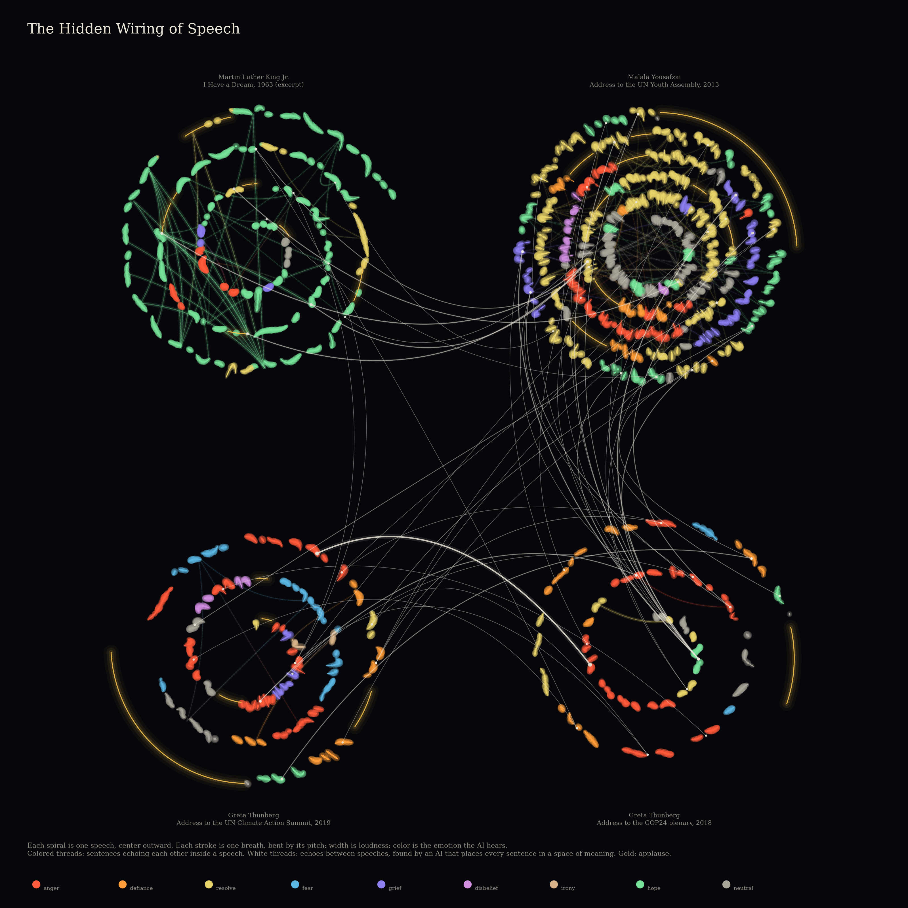

- **File:** `gallery/01_constellation.png` (from `output/compare/art/constellation.png`)
- **What it shows:** All four speeches as spirals on one sheet. Each spiral is one speech read from the center outward; each stroke is one breath (the words between two pauses), bent by the melody of that breath and as wide as it was loud. Colored threads join sentences that echo each other inside a speech; white threads join sentences that echo each other between speeches, so speakers who never cite each other are visibly wired together. Gold arcs mark applause.
- **Data:** breath groups and pitch/loudness contours (output/<id>/structure/breath_groups.csv, frames.csv); emotion tags (sentences.csv); meaning echoes within and across speeches (output/compare/structure/echo_edges.csv); applause events (reaction_events.csv)
- **How it's made:** Each breath's pitch is smoothed to a low-order curve (its melodic gesture) and drawn along an Archimedean spiral; echo threads are curves between the sentences' positions. Rendered in Python (matplotlib) by src/speechart/art/wiring.py.
- **AI and methods:** Whisper large-v3-turbo (speech recognition) with wav2vec2 forced alignment, via WhisperX; pYIN pitch tracking and RMS loudness (signal processing, not AI); PANNs Cnn14 (sound-event recognition trained on AudioSet) for applause, laughter and cheering; Gemini 2.5 Flash (LLM), 5 independent blind runs per speech combined by vote, for rhetorical devices, emotion, intensity and applause prediction; all-MiniLM-L6-v2 (sentence-embedding model) to measure similarity of meaning between sentences.

### Image 02: Speech Bodies: all four speeches

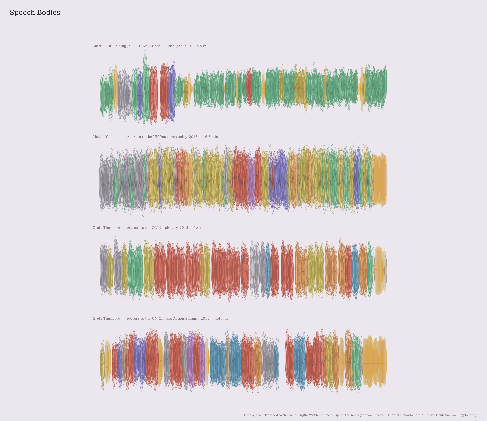

- **File:** `gallery/02_speech_bodies.png` (from `output/compare/art/speech_bodies.png`)
- **What it shows:** Each speech as a solid of stacked discs, all stretched to the same length so their shapes compare. Disc size is loudness, the spine bends with the melody of each breath, pauses pinch the body to a thread, color is the emotion the AI hears, and a faint gold body behind is the room applauding.
- **Data:** frames.csv (loudness, pitch), breath_groups.csv, sentences.csv (emotion), reaction_scores.csv (applause probability)
- **How it's made:** src/speechart/art/bodies.py (matplotlib ellipse collections, ~4500 discs per speech).
- **AI and methods:** pYIN pitch tracking and RMS loudness (signal processing, not AI); Whisper large-v3-turbo (speech recognition) with wav2vec2 forced alignment, via WhisperX; Gemini 2.5 Flash (LLM), 5 independent blind runs per speech combined by vote, for rhetorical devices, emotion, intensity and applause prediction; PANNs Cnn14 (sound-event recognition trained on AudioSet) for applause, laughter and cheering.

### Image 03: The Hidden Wiring of Speech: Greta Thunberg, Address to the UN Climate Action Summit (2019)

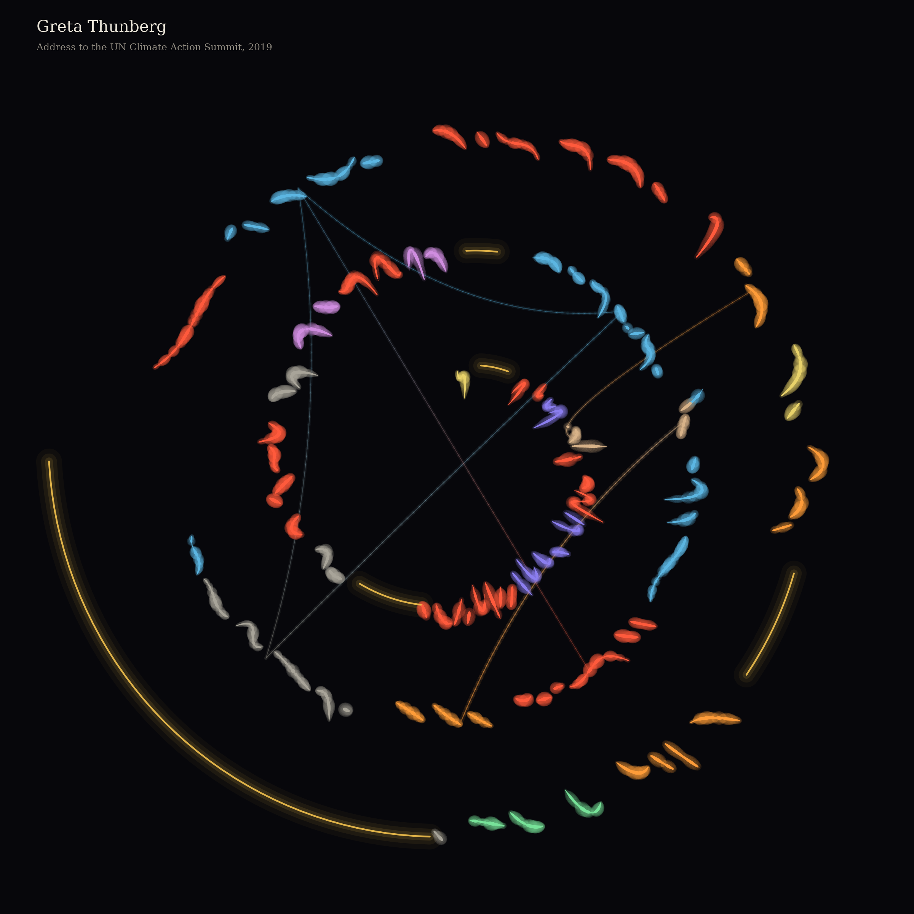

- **File:** `gallery/03_wiring_thunberg_2019_un.png` (from `output/thunberg_2019_un/art/wiring.png`)
- **Speech:** Greta Thunberg, Address to the UN Climate Action Summit, United Nations Headquarters, New York, 2019-09-23. 4.4 min of speech, 39 sentences, 111 words/min, 5 bursts of applause, most common emotion (AI): anger.
- **What it shows:** One speech as a spiral from the center outward. Each stroke is one breath group, its curve the melodic gesture of that breath (a rise, an arch, a fall) and its width the loudness. Pauses are gaps. Color is the emotion the AI hears. Threads through the interior join sentences the AI finds echoing each other in meaning, far apart in time. Gold arcs are applause.
- **Data:** breath_groups.csv, frames.csv, sentences.csv (emotion), reaction_events.csv (applause), echo_edges.csv (within-speech echoes)
- **How it's made:** src/speechart/art/wiring.py (matplotlib); echoes from sentence embeddings, gestures from a cubic fit to each breath's pitch.
- **AI and methods:** Whisper large-v3-turbo (speech recognition) with wav2vec2 forced alignment, via WhisperX; pYIN pitch tracking and RMS loudness (signal processing, not AI); PANNs Cnn14 (sound-event recognition trained on AudioSet) for applause, laughter and cheering; Gemini 2.5 Flash (LLM), 5 independent blind runs per speech combined by vote, for rhetorical devices, emotion, intensity and applause prediction; all-MiniLM-L6-v2 (sentence-embedding model) to measure similarity of meaning between sentences.

### Image 04: The Hidden Wiring of Speech: Greta Thunberg, Address to the COP24 plenary (2018)

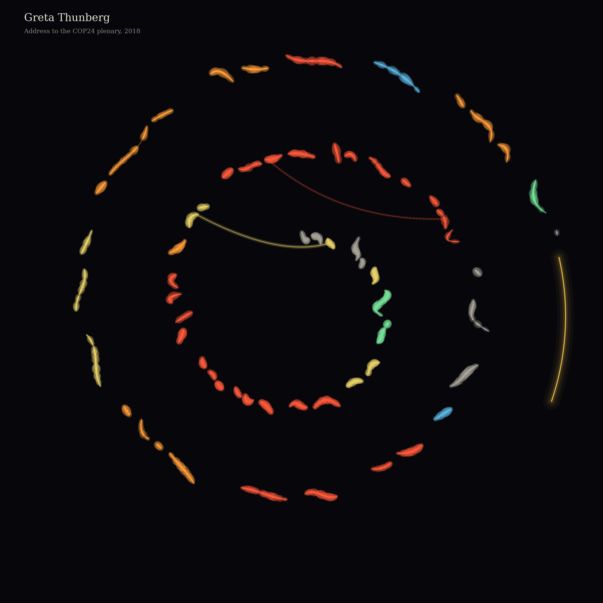

- **File:** `gallery/04_wiring_thunberg_2018_cop24.png` (from `output/thunberg_2018_cop24/art/wiring.png`)
- **Speech:** Greta Thunberg, Address to the COP24 plenary, COP24, Katowice, Poland, 2018-12-12. 3.4 min of speech, 34 sentences, 126 words/min, 1 bursts of applause, most common emotion (AI): anger.
- **What it shows:** One speech as a spiral from the center outward. Each stroke is one breath group, its curve the melodic gesture of that breath (a rise, an arch, a fall) and its width the loudness. Pauses are gaps. Color is the emotion the AI hears. Threads through the interior join sentences the AI finds echoing each other in meaning, far apart in time. Gold arcs are applause.
- **Data:** breath_groups.csv, frames.csv, sentences.csv (emotion), reaction_events.csv (applause), echo_edges.csv (within-speech echoes)
- **How it's made:** src/speechart/art/wiring.py (matplotlib); echoes from sentence embeddings, gestures from a cubic fit to each breath's pitch.
- **AI and methods:** Whisper large-v3-turbo (speech recognition) with wav2vec2 forced alignment, via WhisperX; pYIN pitch tracking and RMS loudness (signal processing, not AI); PANNs Cnn14 (sound-event recognition trained on AudioSet) for applause, laughter and cheering; Gemini 2.5 Flash (LLM), 5 independent blind runs per speech combined by vote, for rhetorical devices, emotion, intensity and applause prediction; all-MiniLM-L6-v2 (sentence-embedding model) to measure similarity of meaning between sentences.

### Image 05: The Hidden Wiring of Speech: Malala Yousafzai, Address to the UN Youth Assembly (2013)

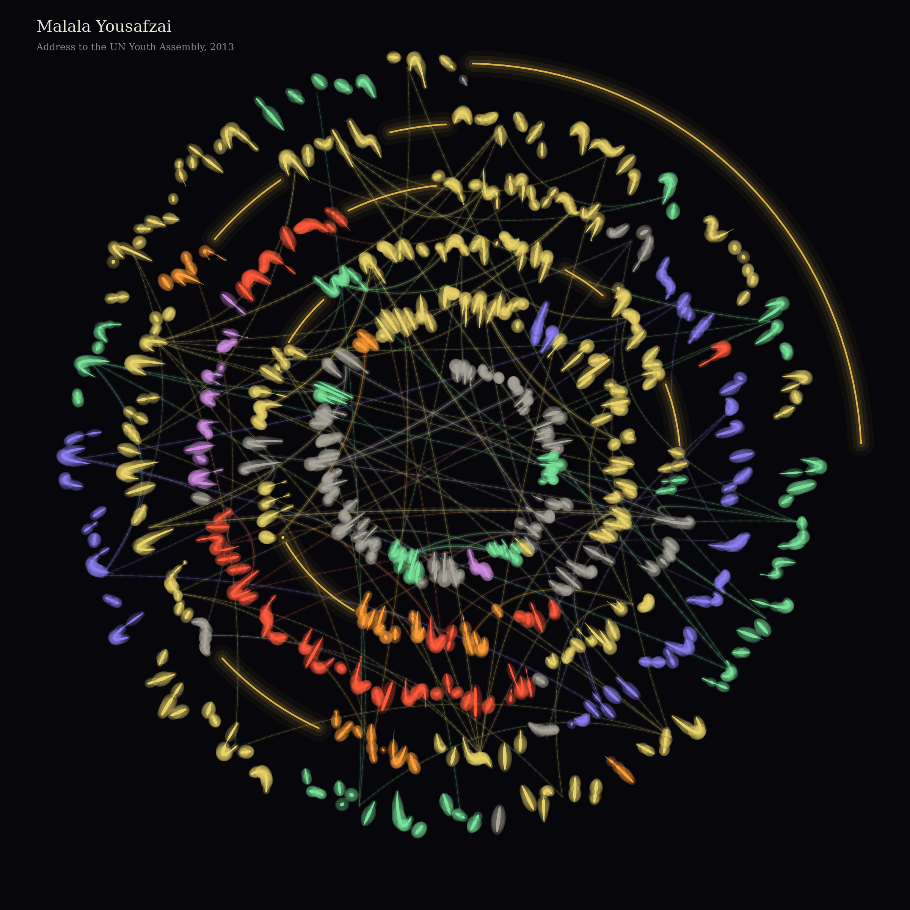

- **File:** `gallery/05_wiring_malala_2013_un.png` (from `output/malala_2013_un/art/wiring.png`)
- **Speech:** Malala Yousafzai, Address to the UN Youth Assembly, United Nations Headquarters, New York, 2013-07-12. 16.8 min of speech, 125 sentences, 91 words/min, 9 bursts of applause, most common emotion (AI): resolve.
- **What it shows:** One speech as a spiral from the center outward. Each stroke is one breath group, its curve the melodic gesture of that breath (a rise, an arch, a fall) and its width the loudness. Pauses are gaps. Color is the emotion the AI hears. Threads through the interior join sentences the AI finds echoing each other in meaning, far apart in time. Gold arcs are applause.
- **Data:** breath_groups.csv, frames.csv, sentences.csv (emotion), reaction_events.csv (applause), echo_edges.csv (within-speech echoes)
- **How it's made:** src/speechart/art/wiring.py (matplotlib); echoes from sentence embeddings, gestures from a cubic fit to each breath's pitch.
- **AI and methods:** Whisper large-v3-turbo (speech recognition) with wav2vec2 forced alignment, via WhisperX; pYIN pitch tracking and RMS loudness (signal processing, not AI); PANNs Cnn14 (sound-event recognition trained on AudioSet) for applause, laughter and cheering; Gemini 2.5 Flash (LLM), 5 independent blind runs per speech combined by vote, for rhetorical devices, emotion, intensity and applause prediction; all-MiniLM-L6-v2 (sentence-embedding model) to measure similarity of meaning between sentences.

### Image 06: The Hidden Wiring of Speech: Martin Luther King Jr., I Have a Dream (1963)

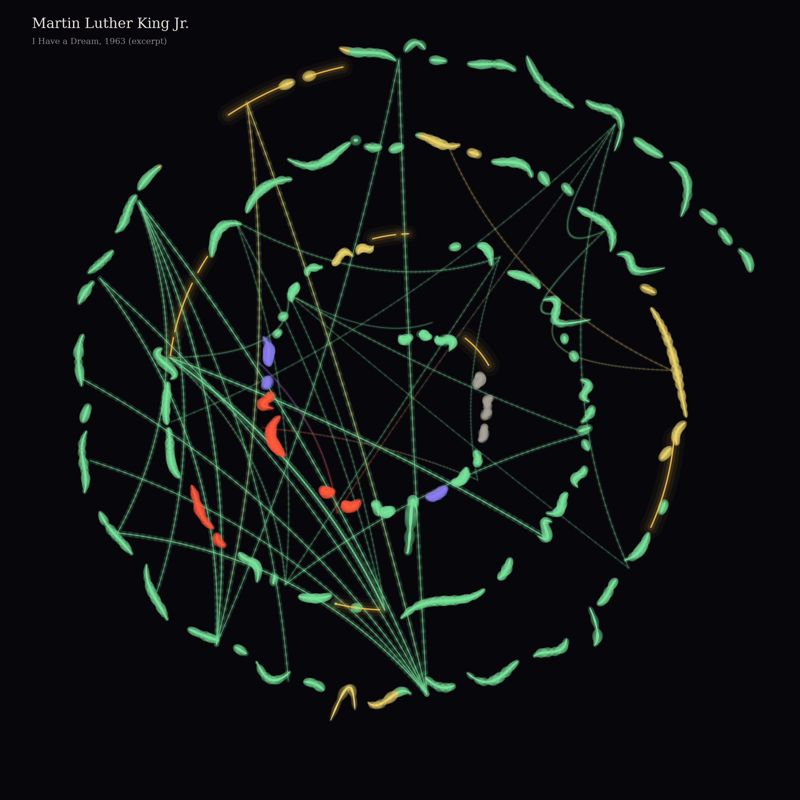

- **File:** `gallery/06_wiring_mlk_1963_dream.png` (from `output/mlk_1963_dream/art/wiring.png`)
- **Speech:** Martin Luther King Jr., I Have a Dream, Lincoln Memorial, Washington, D.C. (March on Washington), 1963-08-28 (edited excerpt). 6.5 min of speech, 45 sentences, 108 words/min, 10 bursts of applause, most common emotion (AI): hope.
- **What it shows:** One speech as a spiral from the center outward. Each stroke is one breath group, its curve the melodic gesture of that breath (a rise, an arch, a fall) and its width the loudness. Pauses are gaps. Color is the emotion the AI hears. Threads through the interior join sentences the AI finds echoing each other in meaning, far apart in time. Gold arcs are applause.
- **Data:** breath_groups.csv, frames.csv, sentences.csv (emotion), reaction_events.csv (applause), echo_edges.csv (within-speech echoes)
- **How it's made:** src/speechart/art/wiring.py (matplotlib); echoes from sentence embeddings, gestures from a cubic fit to each breath's pitch.
- **AI and methods:** Whisper large-v3-turbo (speech recognition) with wav2vec2 forced alignment, via WhisperX; pYIN pitch tracking and RMS loudness (signal processing, not AI); PANNs Cnn14 (sound-event recognition trained on AudioSet) for applause, laughter and cheering; Gemini 2.5 Flash (LLM), 5 independent blind runs per speech combined by vote, for rhetorical devices, emotion, intensity and applause prediction; all-MiniLM-L6-v2 (sentence-embedding model) to measure similarity of meaning between sentences.

### Image 07: Speech Body: Greta Thunberg, Address to the UN Climate Action Summit (2019)

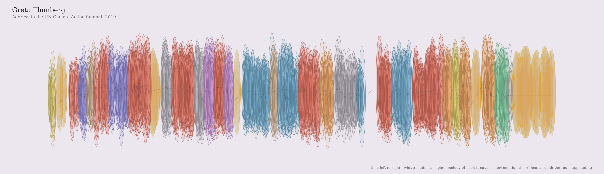

- **File:** `gallery/07_speech_body_thunberg_2019_un.png` (from `output/thunberg_2019_un/art/speech_body.png`)
- **Speech:** Greta Thunberg, Address to the UN Climate Action Summit, United Nations Headquarters, New York, 2019-09-23. 4.4 min of speech, 39 sentences, 111 words/min, 5 bursts of applause, most common emotion (AI): anger.
- **What it shows:** One speech as a solid of stacked discs, read left to right: disc size is loudness, the spine bends with the melody of each breath, pauses pinch the body, color is the emotion the AI hears, and the gold body behind is the room applauding.
- **Data:** frames.csv, breath_groups.csv, sentences.csv, reaction_scores.csv
- **How it's made:** src/speechart/art/bodies.py.
- **AI and methods:** pYIN pitch tracking and RMS loudness (signal processing, not AI); Whisper large-v3-turbo (speech recognition) with wav2vec2 forced alignment, via WhisperX; Gemini 2.5 Flash (LLM), 5 independent blind runs per speech combined by vote, for rhetorical devices, emotion, intensity and applause prediction; PANNs Cnn14 (sound-event recognition trained on AudioSet) for applause, laughter and cheering.

### Image 08: Speech Body: Greta Thunberg, Address to the COP24 plenary (2018)

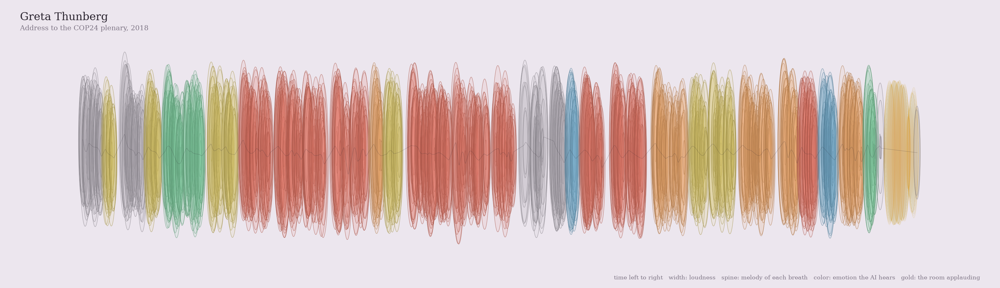

- **File:** `gallery/08_speech_body_thunberg_2018_cop24.png` (from `output/thunberg_2018_cop24/art/speech_body.png`)
- **Speech:** Greta Thunberg, Address to the COP24 plenary, COP24, Katowice, Poland, 2018-12-12. 3.4 min of speech, 34 sentences, 126 words/min, 1 bursts of applause, most common emotion (AI): anger.
- **What it shows:** One speech as a solid of stacked discs, read left to right: disc size is loudness, the spine bends with the melody of each breath, pauses pinch the body, color is the emotion the AI hears, and the gold body behind is the room applauding.
- **Data:** frames.csv, breath_groups.csv, sentences.csv, reaction_scores.csv
- **How it's made:** src/speechart/art/bodies.py.
- **AI and methods:** pYIN pitch tracking and RMS loudness (signal processing, not AI); Whisper large-v3-turbo (speech recognition) with wav2vec2 forced alignment, via WhisperX; Gemini 2.5 Flash (LLM), 5 independent blind runs per speech combined by vote, for rhetorical devices, emotion, intensity and applause prediction; PANNs Cnn14 (sound-event recognition trained on AudioSet) for applause, laughter and cheering.

### Image 09: Speech Body: Malala Yousafzai, Address to the UN Youth Assembly (2013)

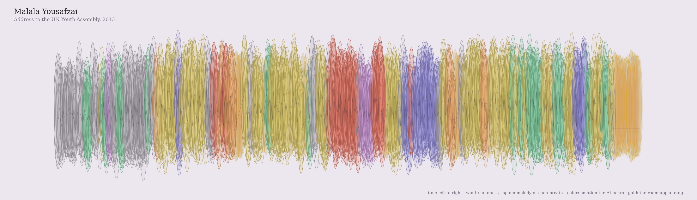

- **File:** `gallery/09_speech_body_malala_2013_un.png` (from `output/malala_2013_un/art/speech_body.png`)
- **Speech:** Malala Yousafzai, Address to the UN Youth Assembly, United Nations Headquarters, New York, 2013-07-12. 16.8 min of speech, 125 sentences, 91 words/min, 9 bursts of applause, most common emotion (AI): resolve.
- **What it shows:** One speech as a solid of stacked discs, read left to right: disc size is loudness, the spine bends with the melody of each breath, pauses pinch the body, color is the emotion the AI hears, and the gold body behind is the room applauding.
- **Data:** frames.csv, breath_groups.csv, sentences.csv, reaction_scores.csv
- **How it's made:** src/speechart/art/bodies.py.
- **AI and methods:** pYIN pitch tracking and RMS loudness (signal processing, not AI); Whisper large-v3-turbo (speech recognition) with wav2vec2 forced alignment, via WhisperX; Gemini 2.5 Flash (LLM), 5 independent blind runs per speech combined by vote, for rhetorical devices, emotion, intensity and applause prediction; PANNs Cnn14 (sound-event recognition trained on AudioSet) for applause, laughter and cheering.

### Image 10: Speech Body: Martin Luther King Jr., I Have a Dream (1963)

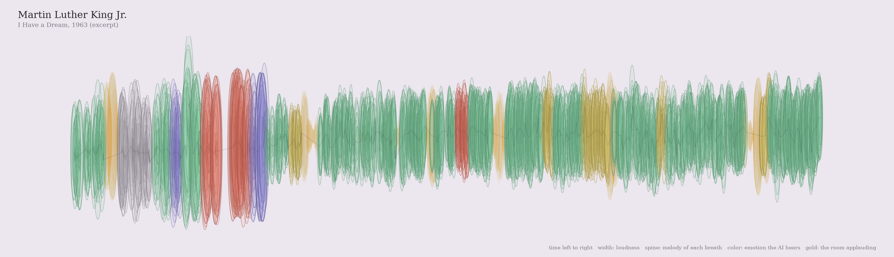

- **File:** `gallery/10_speech_body_mlk_1963_dream.png` (from `output/mlk_1963_dream/art/speech_body.png`)
- **Speech:** Martin Luther King Jr., I Have a Dream, Lincoln Memorial, Washington, D.C. (March on Washington), 1963-08-28 (edited excerpt). 6.5 min of speech, 45 sentences, 108 words/min, 10 bursts of applause, most common emotion (AI): hope.
- **What it shows:** One speech as a solid of stacked discs, read left to right: disc size is loudness, the spine bends with the melody of each breath, pauses pinch the body, color is the emotion the AI hears, and the gold body behind is the room applauding.
- **Data:** frames.csv, breath_groups.csv, sentences.csv, reaction_scores.csv
- **How it's made:** src/speechart/art/bodies.py.
- **AI and methods:** pYIN pitch tracking and RMS loudness (signal processing, not AI); Whisper large-v3-turbo (speech recognition) with wav2vec2 forced alignment, via WhisperX; Gemini 2.5 Flash (LLM), 5 independent blind runs per speech combined by vote, for rhetorical devices, emotion, intensity and applause prediction; PANNs Cnn14 (sound-event recognition trained on AudioSet) for applause, laughter and cheering.

## Earlier artworks

### Image 11: Applause Landscape: Greta Thunberg, Address to the UN Climate Action Summit (2019)

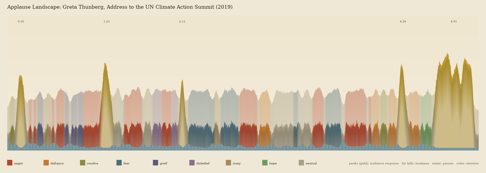

- **File:** `gallery/11_landscape_thunberg_2019_un.png` (from `output/thunberg_2019_un/art/applause_landscape.png`)
- **Speech:** Greta Thunberg, Address to the UN Climate Action Summit, United Nations Headquarters, New York, 2019-09-23. 4.4 min of speech, 39 sentences, 111 words/min, 5 bursts of applause, most common emotion (AI): anger.
- **What it shows:** The speech as a mountain panorama read left to right. Gold peaks rise exactly where the audience responded; a paler far range follows loudness; ridge color is the emotion the AI hears; water at the base marks pauses.
- **Data:** timeline_100ms.csv (loudness, pauses, applause probability), words_timeline.csv (emotion)
- **How it's made:** src/speechart/art/landscape.py; also writes a 16-bit depth map for depth-conditioned AI painting.
- **AI and methods:** pYIN pitch tracking and RMS loudness (signal processing, not AI); PANNs Cnn14 (sound-event recognition trained on AudioSet) for applause, laughter and cheering; Gemini 2.5 Flash (LLM), 5 independent blind runs per speech combined by vote, for rhetorical devices, emotion, intensity and applause prediction; Whisper large-v3-turbo (speech recognition) with wav2vec2 forced alignment, via WhisperX.

### Image 12: Applause Landscape: Greta Thunberg, Address to the COP24 plenary (2018)

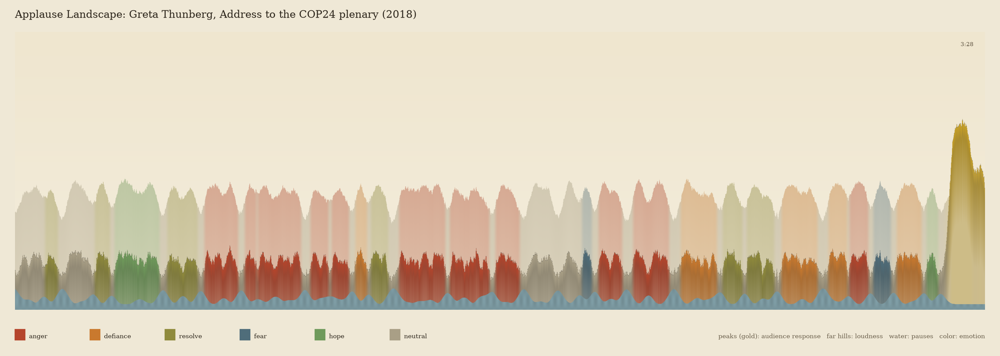

- **File:** `gallery/12_landscape_thunberg_2018_cop24.png` (from `output/thunberg_2018_cop24/art/applause_landscape.png`)
- **Speech:** Greta Thunberg, Address to the COP24 plenary, COP24, Katowice, Poland, 2018-12-12. 3.4 min of speech, 34 sentences, 126 words/min, 1 bursts of applause, most common emotion (AI): anger.
- **What it shows:** The speech as a mountain panorama read left to right. Gold peaks rise exactly where the audience responded; a paler far range follows loudness; ridge color is the emotion the AI hears; water at the base marks pauses.
- **Data:** timeline_100ms.csv (loudness, pauses, applause probability), words_timeline.csv (emotion)
- **How it's made:** src/speechart/art/landscape.py; also writes a 16-bit depth map for depth-conditioned AI painting.
- **AI and methods:** pYIN pitch tracking and RMS loudness (signal processing, not AI); PANNs Cnn14 (sound-event recognition trained on AudioSet) for applause, laughter and cheering; Gemini 2.5 Flash (LLM), 5 independent blind runs per speech combined by vote, for rhetorical devices, emotion, intensity and applause prediction; Whisper large-v3-turbo (speech recognition) with wav2vec2 forced alignment, via WhisperX.

### Image 13: Applause Landscape: Malala Yousafzai, Address to the UN Youth Assembly (2013)

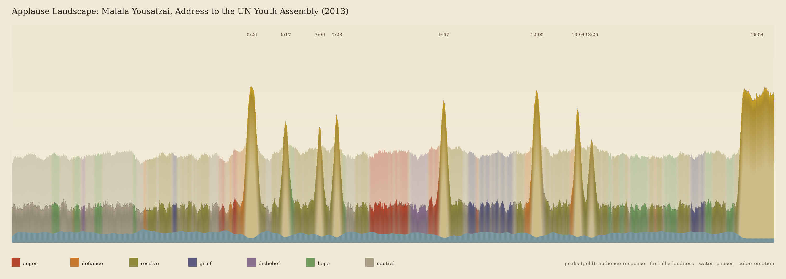

- **File:** `gallery/13_landscape_malala_2013_un.png` (from `output/malala_2013_un/art/applause_landscape.png`)
- **Speech:** Malala Yousafzai, Address to the UN Youth Assembly, United Nations Headquarters, New York, 2013-07-12. 16.8 min of speech, 125 sentences, 91 words/min, 9 bursts of applause, most common emotion (AI): resolve.
- **What it shows:** The speech as a mountain panorama read left to right. Gold peaks rise exactly where the audience responded; a paler far range follows loudness; ridge color is the emotion the AI hears; water at the base marks pauses.
- **Data:** timeline_100ms.csv (loudness, pauses, applause probability), words_timeline.csv (emotion)
- **How it's made:** src/speechart/art/landscape.py; also writes a 16-bit depth map for depth-conditioned AI painting.
- **AI and methods:** pYIN pitch tracking and RMS loudness (signal processing, not AI); PANNs Cnn14 (sound-event recognition trained on AudioSet) for applause, laughter and cheering; Gemini 2.5 Flash (LLM), 5 independent blind runs per speech combined by vote, for rhetorical devices, emotion, intensity and applause prediction; Whisper large-v3-turbo (speech recognition) with wav2vec2 forced alignment, via WhisperX.

### Image 14: Applause Landscape: Martin Luther King Jr., I Have a Dream (1963)

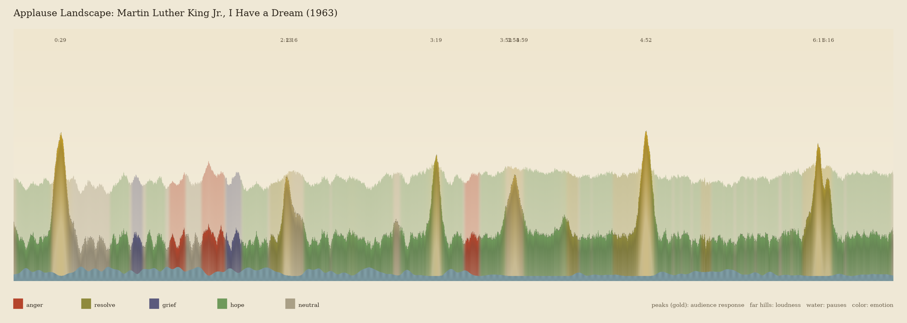

- **File:** `gallery/14_landscape_mlk_1963_dream.png` (from `output/mlk_1963_dream/art/applause_landscape.png`)
- **Speech:** Martin Luther King Jr., I Have a Dream, Lincoln Memorial, Washington, D.C. (March on Washington), 1963-08-28 (edited excerpt). 6.5 min of speech, 45 sentences, 108 words/min, 10 bursts of applause, most common emotion (AI): hope.
- **What it shows:** The speech as a mountain panorama read left to right. Gold peaks rise exactly where the audience responded; a paler far range follows loudness; ridge color is the emotion the AI hears; water at the base marks pauses.
- **Data:** timeline_100ms.csv (loudness, pauses, applause probability), words_timeline.csv (emotion)
- **How it's made:** src/speechart/art/landscape.py; also writes a 16-bit depth map for depth-conditioned AI painting.
- **AI and methods:** pYIN pitch tracking and RMS loudness (signal processing, not AI); PANNs Cnn14 (sound-event recognition trained on AudioSet) for applause, laughter and cheering; Gemini 2.5 Flash (LLM), 5 independent blind runs per speech combined by vote, for rhetorical devices, emotion, intensity and applause prediction; Whisper large-v3-turbo (speech recognition) with wav2vec2 forced alignment, via WhisperX.

### Image 15: Ripples: Greta Thunberg, Address to the UN Climate Action Summit (2019)

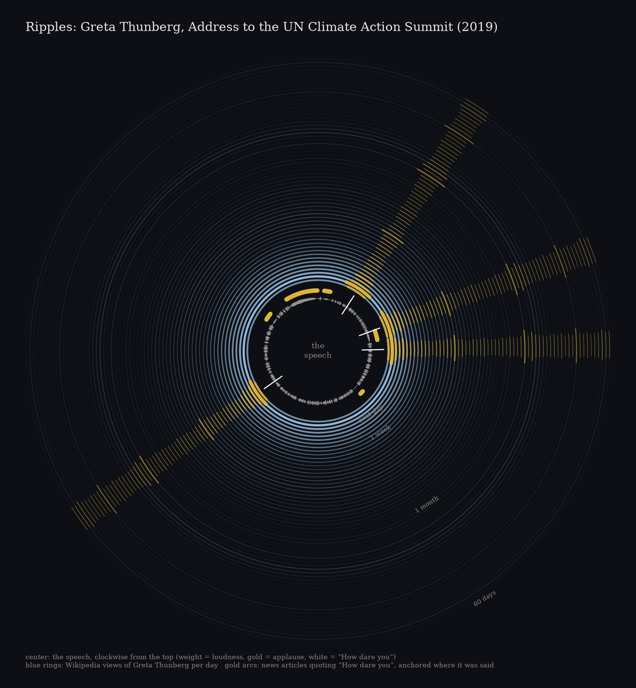

- **File:** `gallery/15_ripples_thunberg_2019_un.png` (from `output/thunberg_2019_un/art/ripples.png`)
- **Speech:** Greta Thunberg, Address to the UN Climate Action Summit, United Nations Headquarters, New York, 2019-09-23. 4.4 min of speech, 39 sentences, 111 words/min, 5 bursts of applause, most common emotion (AI): anger.
- **What it shows:** The speech at the center as a ring, read clockwise; rings spreading outward are the days after it, bright with attention to the speaker on Wikipedia; gold rays are news articles quoting the speech's key phrase, drawn at the angles where it was spoken so each echo traces back to its moment.
- **Data:** frames.csv, reaction_events.csv, aftermath_wikipedia.csv (Wikimedia pageviews), aftermath_gdelt.csv (GDELT news counts)
- **How it's made:** src/speechart/art/ripples.py. Aftermath data exists only from 2015 on, so only the Thunberg speeches have this piece.
- **AI and methods:** pYIN pitch tracking and RMS loudness (signal processing, not AI); PANNs Cnn14 (sound-event recognition trained on AudioSet) for applause, laughter and cheering; Whisper large-v3-turbo (speech recognition) with wav2vec2 forced alignment, via WhisperX.

### Image 16: Ripples: Greta Thunberg, Address to the COP24 plenary (2018)

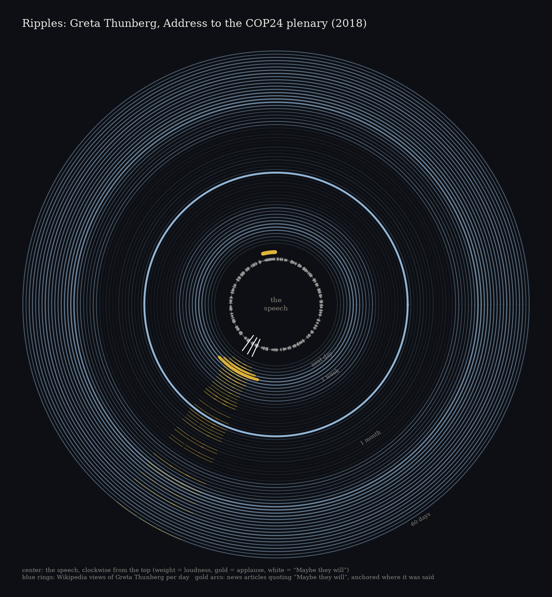

- **File:** `gallery/16_ripples_thunberg_2018_cop24.png` (from `output/thunberg_2018_cop24/art/ripples.png`)
- **Speech:** Greta Thunberg, Address to the COP24 plenary, COP24, Katowice, Poland, 2018-12-12. 3.4 min of speech, 34 sentences, 126 words/min, 1 bursts of applause, most common emotion (AI): anger.
- **What it shows:** The speech at the center as a ring, read clockwise; rings spreading outward are the days after it, bright with attention to the speaker on Wikipedia; gold rays are news articles quoting the speech's key phrase, drawn at the angles where it was spoken so each echo traces back to its moment.
- **Data:** frames.csv, reaction_events.csv, aftermath_wikipedia.csv (Wikimedia pageviews), aftermath_gdelt.csv (GDELT news counts)
- **How it's made:** src/speechart/art/ripples.py. Aftermath data exists only from 2015 on, so only the Thunberg speeches have this piece.
- **AI and methods:** pYIN pitch tracking and RMS loudness (signal processing, not AI); PANNs Cnn14 (sound-event recognition trained on AudioSet) for applause, laughter and cheering; Whisper large-v3-turbo (speech recognition) with wav2vec2 forced alignment, via WhisperX.

### Image 17: Breath Scroll: Greta Thunberg, Address to the UN Climate Action Summit (2019)

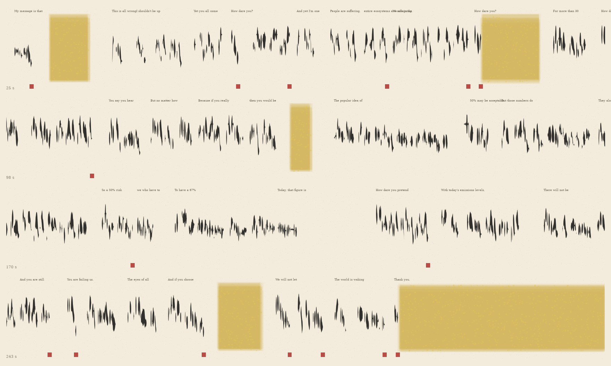

- **File:** `gallery/17_breath_scroll_thunberg_2019_un.png` (from `output/thunberg_2019_un/art/breath_scroll_preview.png`)
- **Speech:** Greta Thunberg, Address to the UN Climate Action Summit, United Nations Headquarters, New York, 2019-09-23. 4.4 min of speech, 39 sentences, 111 words/min, 5 bursts of applause, most common emotion (AI): anger.
- **What it shows:** The speech as an ink scroll, cut into rows. Each word is a brush stroke whose weight follows loudness and whose height follows pitch; pauses are blank paper; gold leaf marks applause; red seals mark the sentences the AI predicted would draw applause.
- **Data:** frames.csv, words_timeline.csv, reaction_events.csv, sentences.csv (applause prediction)
- **How it's made:** src/speechart/art/breath_scroll.py.
- **AI and methods:** Whisper large-v3-turbo (speech recognition) with wav2vec2 forced alignment, via WhisperX; pYIN pitch tracking and RMS loudness (signal processing, not AI); PANNs Cnn14 (sound-event recognition trained on AudioSet) for applause, laughter and cheering; Gemini 2.5 Flash (LLM), 5 independent blind runs per speech combined by vote, for rhetorical devices, emotion, intensity and applause prediction.

### Image 18: Breath Scroll: Greta Thunberg, Address to the COP24 plenary (2018)

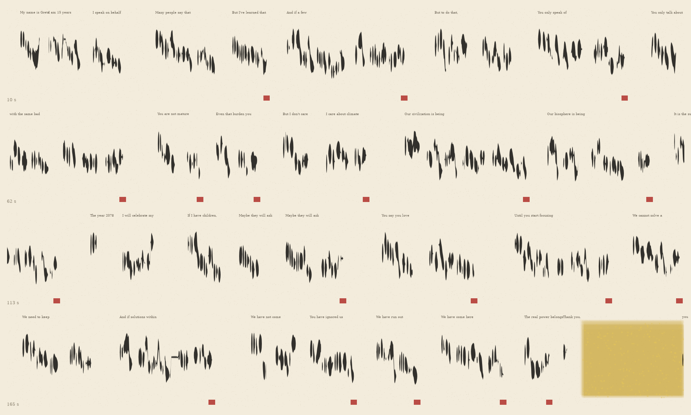

- **File:** `gallery/18_breath_scroll_thunberg_2018_cop24.png` (from `output/thunberg_2018_cop24/art/breath_scroll_preview.png`)
- **Speech:** Greta Thunberg, Address to the COP24 plenary, COP24, Katowice, Poland, 2018-12-12. 3.4 min of speech, 34 sentences, 126 words/min, 1 bursts of applause, most common emotion (AI): anger.
- **What it shows:** The speech as an ink scroll, cut into rows. Each word is a brush stroke whose weight follows loudness and whose height follows pitch; pauses are blank paper; gold leaf marks applause; red seals mark the sentences the AI predicted would draw applause.
- **Data:** frames.csv, words_timeline.csv, reaction_events.csv, sentences.csv (applause prediction)
- **How it's made:** src/speechart/art/breath_scroll.py.
- **AI and methods:** Whisper large-v3-turbo (speech recognition) with wav2vec2 forced alignment, via WhisperX; pYIN pitch tracking and RMS loudness (signal processing, not AI); PANNs Cnn14 (sound-event recognition trained on AudioSet) for applause, laughter and cheering; Gemini 2.5 Flash (LLM), 5 independent blind runs per speech combined by vote, for rhetorical devices, emotion, intensity and applause prediction.

### Image 19: Breath Scroll: Malala Yousafzai, Address to the UN Youth Assembly (2013)

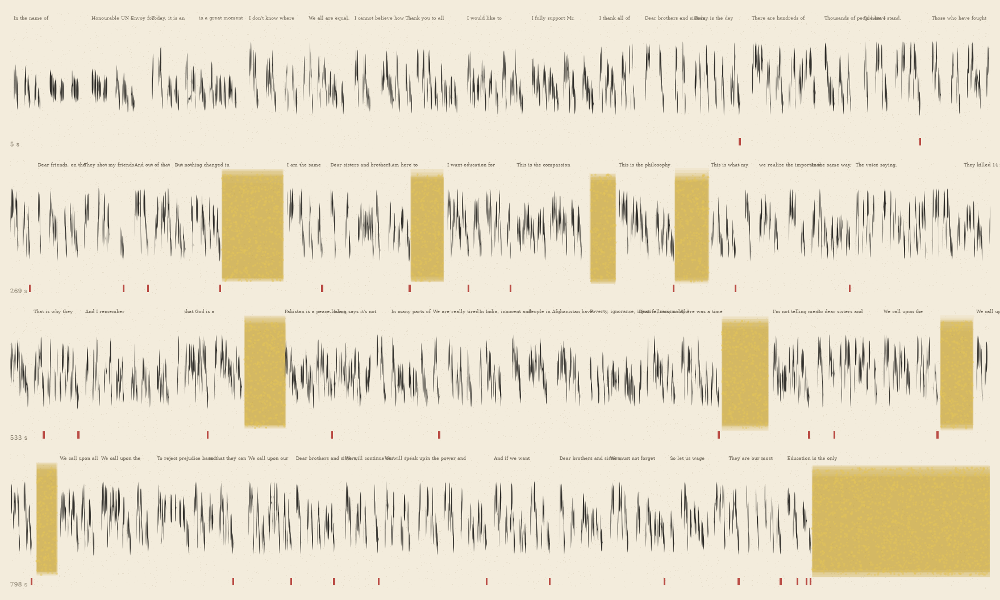

- **File:** `gallery/19_breath_scroll_malala_2013_un.png` (from `output/malala_2013_un/art/breath_scroll_preview.png`)
- **Speech:** Malala Yousafzai, Address to the UN Youth Assembly, United Nations Headquarters, New York, 2013-07-12. 16.8 min of speech, 125 sentences, 91 words/min, 9 bursts of applause, most common emotion (AI): resolve.
- **What it shows:** The speech as an ink scroll, cut into rows. Each word is a brush stroke whose weight follows loudness and whose height follows pitch; pauses are blank paper; gold leaf marks applause; red seals mark the sentences the AI predicted would draw applause.
- **Data:** frames.csv, words_timeline.csv, reaction_events.csv, sentences.csv (applause prediction)
- **How it's made:** src/speechart/art/breath_scroll.py.
- **AI and methods:** Whisper large-v3-turbo (speech recognition) with wav2vec2 forced alignment, via WhisperX; pYIN pitch tracking and RMS loudness (signal processing, not AI); PANNs Cnn14 (sound-event recognition trained on AudioSet) for applause, laughter and cheering; Gemini 2.5 Flash (LLM), 5 independent blind runs per speech combined by vote, for rhetorical devices, emotion, intensity and applause prediction.

### Image 20: Breath Scroll: Martin Luther King Jr., I Have a Dream (1963)

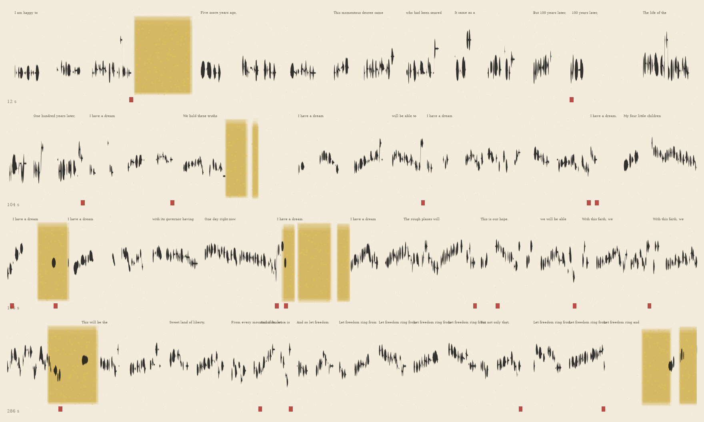

- **File:** `gallery/20_breath_scroll_mlk_1963_dream.png` (from `output/mlk_1963_dream/art/breath_scroll_preview.png`)
- **Speech:** Martin Luther King Jr., I Have a Dream, Lincoln Memorial, Washington, D.C. (March on Washington), 1963-08-28 (edited excerpt). 6.5 min of speech, 45 sentences, 108 words/min, 10 bursts of applause, most common emotion (AI): hope.
- **What it shows:** The speech as an ink scroll, cut into rows. Each word is a brush stroke whose weight follows loudness and whose height follows pitch; pauses are blank paper; gold leaf marks applause; red seals mark the sentences the AI predicted would draw applause.
- **Data:** frames.csv, words_timeline.csv, reaction_events.csv, sentences.csv (applause prediction)
- **How it's made:** src/speechart/art/breath_scroll.py.
- **AI and methods:** Whisper large-v3-turbo (speech recognition) with wav2vec2 forced alignment, via WhisperX; pYIN pitch tracking and RMS loudness (signal processing, not AI); PANNs Cnn14 (sound-event recognition trained on AudioSet) for applause, laughter and cheering; Gemini 2.5 Flash (LLM), 5 independent blind runs per speech combined by vote, for rhetorical devices, emotion, intensity and applause prediction.

### Image 21: Speech Fingerprint: Greta Thunberg, Address to the UN Climate Action Summit (2019)

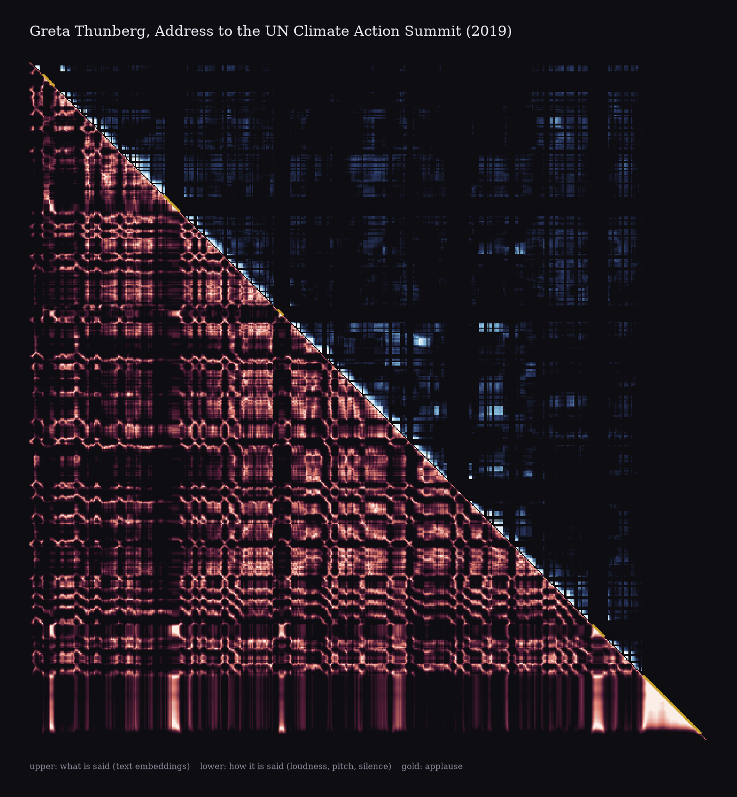

- **File:** `gallery/21_fingerprint_thunberg_2019_un.png` (from `output/thunberg_2019_un/art/speech_fingerprint.png`)
- **Speech:** Greta Thunberg, Address to the UN Climate Action Summit, United Nations Headquarters, New York, 2019-09-23. 4.4 min of speech, 39 sentences, 111 words/min, 5 bursts of applause, most common emotion (AI): anger.
- **What it shows:** A self-similarity matrix: time runs along both axes and a cell is bright when two moments resemble each other. Upper half: what is said (meaning); lower half: how it is said (loudness, pitch, silence). Repetition shows as threads, sections as blocks; gold on the diagonal is applause.
- **Data:** timeline_100ms.csv, words_timeline.csv
- **How it's made:** src/speechart/art/fingerprint.py.
- **AI and methods:** all-MiniLM-L6-v2 (sentence-embedding model) to measure similarity of meaning between sentences; Whisper large-v3-turbo (speech recognition) with wav2vec2 forced alignment, via WhisperX; pYIN pitch tracking and RMS loudness (signal processing, not AI); PANNs Cnn14 (sound-event recognition trained on AudioSet) for applause, laughter and cheering.

### Image 22: Speech Fingerprint: Greta Thunberg, Address to the COP24 plenary (2018)

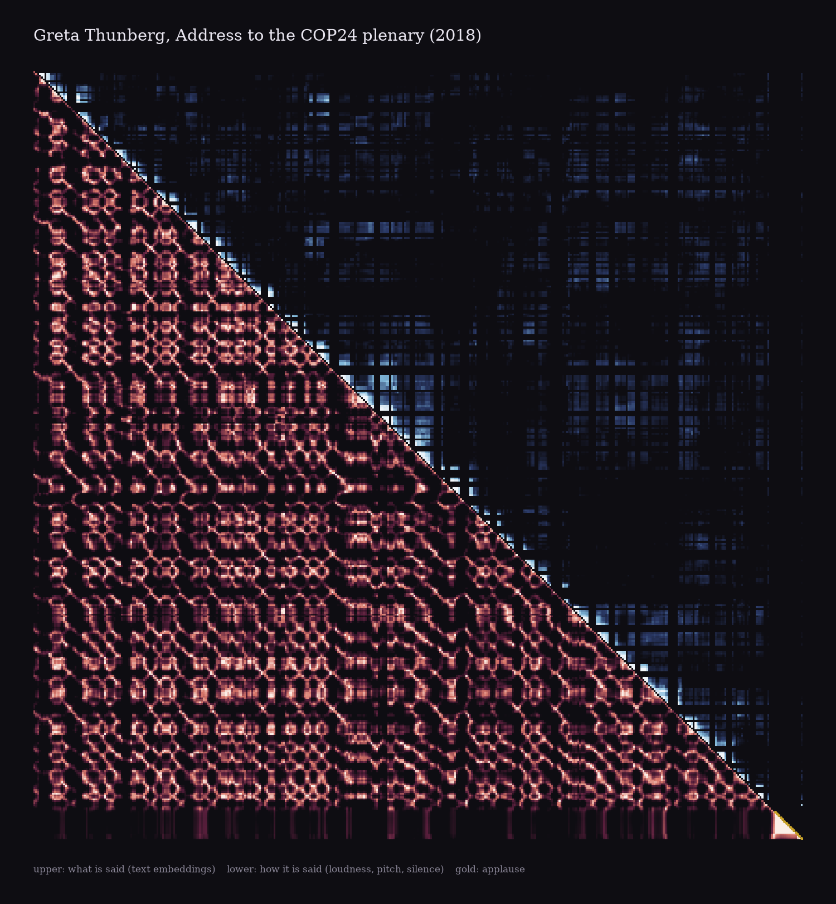

- **File:** `gallery/22_fingerprint_thunberg_2018_cop24.png` (from `output/thunberg_2018_cop24/art/speech_fingerprint.png`)
- **Speech:** Greta Thunberg, Address to the COP24 plenary, COP24, Katowice, Poland, 2018-12-12. 3.4 min of speech, 34 sentences, 126 words/min, 1 bursts of applause, most common emotion (AI): anger.
- **What it shows:** A self-similarity matrix: time runs along both axes and a cell is bright when two moments resemble each other. Upper half: what is said (meaning); lower half: how it is said (loudness, pitch, silence). Repetition shows as threads, sections as blocks; gold on the diagonal is applause.
- **Data:** timeline_100ms.csv, words_timeline.csv
- **How it's made:** src/speechart/art/fingerprint.py.
- **AI and methods:** all-MiniLM-L6-v2 (sentence-embedding model) to measure similarity of meaning between sentences; Whisper large-v3-turbo (speech recognition) with wav2vec2 forced alignment, via WhisperX; pYIN pitch tracking and RMS loudness (signal processing, not AI); PANNs Cnn14 (sound-event recognition trained on AudioSet) for applause, laughter and cheering.

### Image 23: Speech Fingerprint: Malala Yousafzai, Address to the UN Youth Assembly (2013)

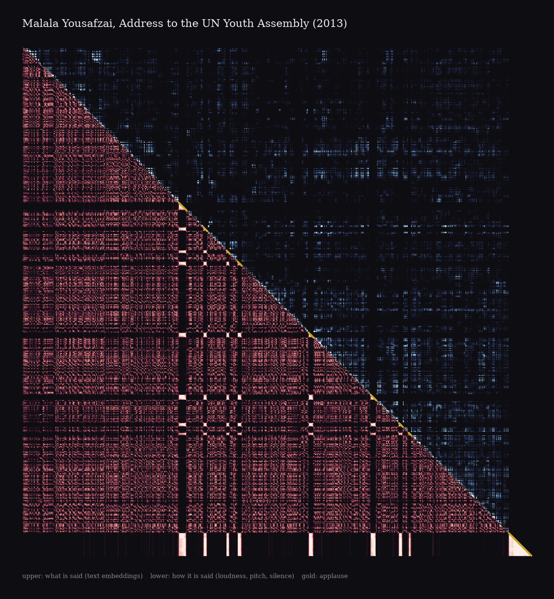

- **File:** `gallery/23_fingerprint_malala_2013_un.png` (from `output/malala_2013_un/art/speech_fingerprint.png`)
- **Speech:** Malala Yousafzai, Address to the UN Youth Assembly, United Nations Headquarters, New York, 2013-07-12. 16.8 min of speech, 125 sentences, 91 words/min, 9 bursts of applause, most common emotion (AI): resolve.
- **What it shows:** A self-similarity matrix: time runs along both axes and a cell is bright when two moments resemble each other. Upper half: what is said (meaning); lower half: how it is said (loudness, pitch, silence). Repetition shows as threads, sections as blocks; gold on the diagonal is applause.
- **Data:** timeline_100ms.csv, words_timeline.csv
- **How it's made:** src/speechart/art/fingerprint.py.
- **AI and methods:** all-MiniLM-L6-v2 (sentence-embedding model) to measure similarity of meaning between sentences; Whisper large-v3-turbo (speech recognition) with wav2vec2 forced alignment, via WhisperX; pYIN pitch tracking and RMS loudness (signal processing, not AI); PANNs Cnn14 (sound-event recognition trained on AudioSet) for applause, laughter and cheering.

### Image 24: Speech Fingerprint: Martin Luther King Jr., I Have a Dream (1963)

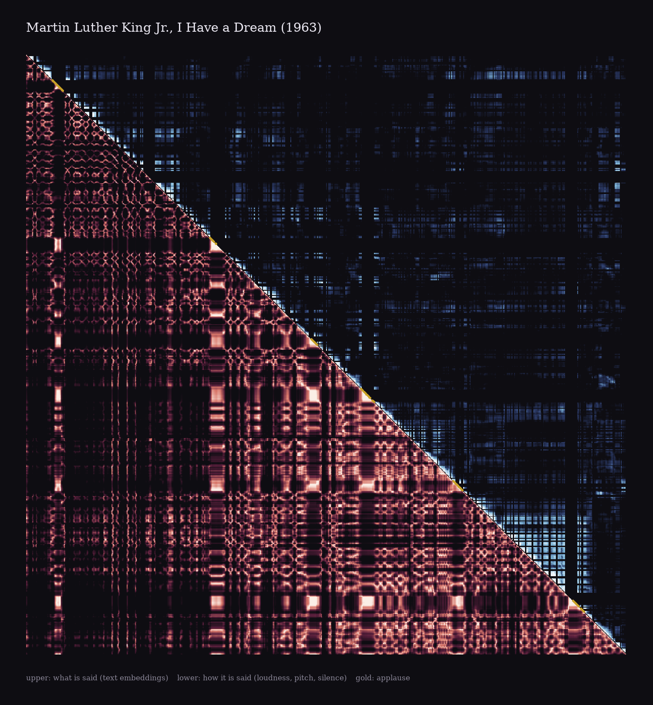

- **File:** `gallery/24_fingerprint_mlk_1963_dream.png` (from `output/mlk_1963_dream/art/speech_fingerprint.png`)
- **Speech:** Martin Luther King Jr., I Have a Dream, Lincoln Memorial, Washington, D.C. (March on Washington), 1963-08-28 (edited excerpt). 6.5 min of speech, 45 sentences, 108 words/min, 10 bursts of applause, most common emotion (AI): hope.
- **What it shows:** A self-similarity matrix: time runs along both axes and a cell is bright when two moments resemble each other. Upper half: what is said (meaning); lower half: how it is said (loudness, pitch, silence). Repetition shows as threads, sections as blocks; gold on the diagonal is applause.
- **Data:** timeline_100ms.csv, words_timeline.csv
- **How it's made:** src/speechart/art/fingerprint.py.
- **AI and methods:** all-MiniLM-L6-v2 (sentence-embedding model) to measure similarity of meaning between sentences; Whisper large-v3-turbo (speech recognition) with wav2vec2 forced alignment, via WhisperX; pYIN pitch tracking and RMS loudness (signal processing, not AI); PANNs Cnn14 (sound-event recognition trained on AudioSet) for applause, laughter and cheering.

## Annotated and analysis images

### Image 25: The Hidden Wiring of Speech, annotated: Greta Thunberg, Address to the UN Climate Action Summit (2019)

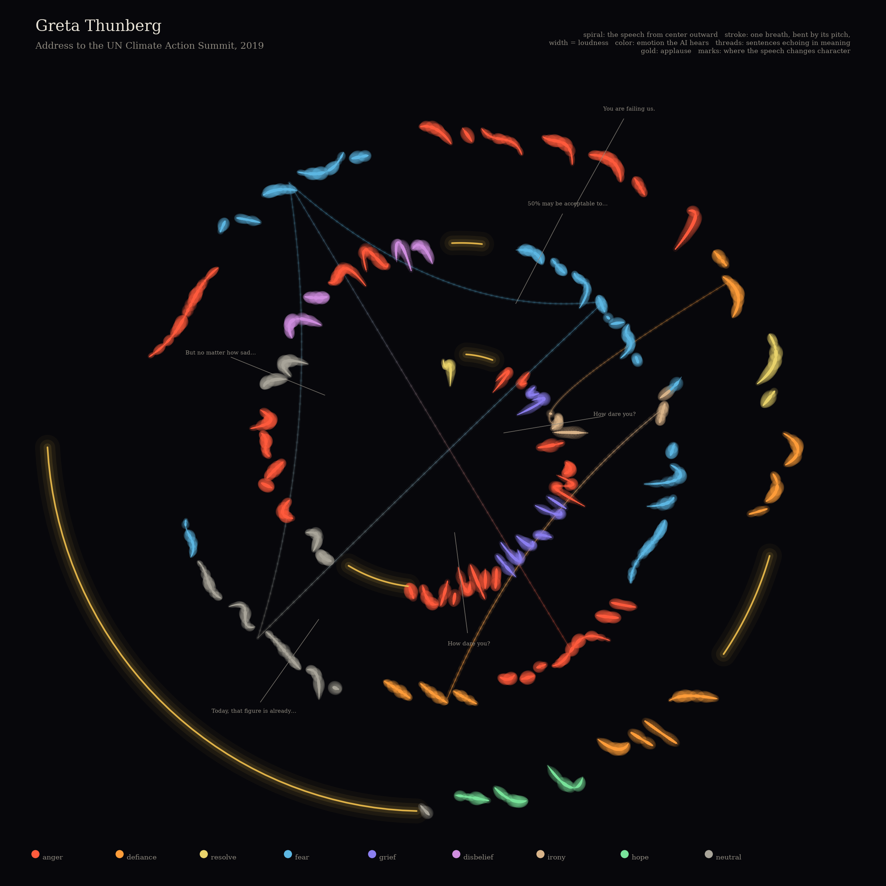

- **File:** `gallery/25_wiring_annotated_thunberg_2019_un.png` (from `output/thunberg_2019_un/art/wiring_annotated.png`)
- **Speech:** Greta Thunberg, Address to the UN Climate Action Summit, United Nations Headquarters, New York, 2019-09-23. 4.4 min of speech, 39 sentences, 111 words/min, 5 bursts of applause, most common emotion (AI): anger.
- **What it shows:** The same portrait with the speech's sections marked and labeled by the words that open them, plus a legend. The sections were found by a novelty detector that only sees changes in meaning and delivery, yet they fall on the speech's real rhetorical turns.
- **Data:** as the portrait, plus output/<id>/structure/sections.csv
- **How it's made:** src/speechart/art/wiring.py with annotated=True.
- **AI and methods:** Whisper large-v3-turbo (speech recognition) with wav2vec2 forced alignment, via WhisperX; pYIN pitch tracking and RMS loudness (signal processing, not AI); PANNs Cnn14 (sound-event recognition trained on AudioSet) for applause, laughter and cheering; Gemini 2.5 Flash (LLM), 5 independent blind runs per speech combined by vote, for rhetorical devices, emotion, intensity and applause prediction; all-MiniLM-L6-v2 (sentence-embedding model) to measure similarity of meaning between sentences; Foote novelty on a self-similarity matrix (from music analysis) to find sections.

### Image 26: The Hidden Wiring of Speech, annotated: Greta Thunberg, Address to the COP24 plenary (2018)

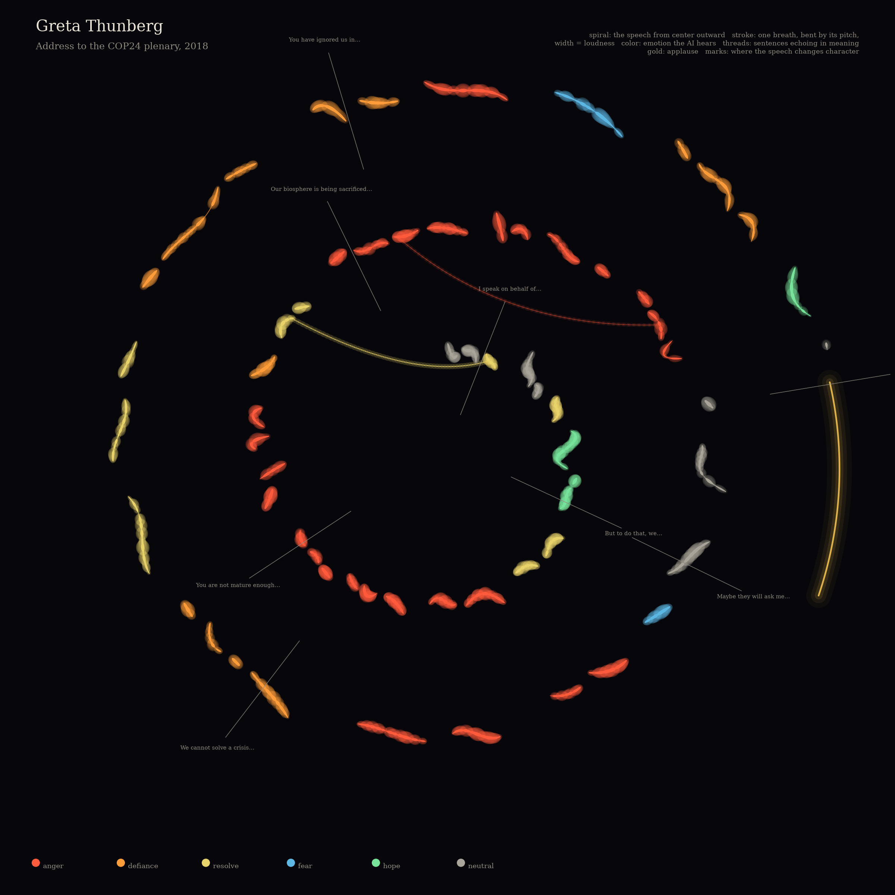

- **File:** `gallery/26_wiring_annotated_thunberg_2018_cop24.png` (from `output/thunberg_2018_cop24/art/wiring_annotated.png`)
- **Speech:** Greta Thunberg, Address to the COP24 plenary, COP24, Katowice, Poland, 2018-12-12. 3.4 min of speech, 34 sentences, 126 words/min, 1 bursts of applause, most common emotion (AI): anger.
- **What it shows:** The same portrait with the speech's sections marked and labeled by the words that open them, plus a legend. The sections were found by a novelty detector that only sees changes in meaning and delivery, yet they fall on the speech's real rhetorical turns.
- **Data:** as the portrait, plus output/<id>/structure/sections.csv
- **How it's made:** src/speechart/art/wiring.py with annotated=True.
- **AI and methods:** Whisper large-v3-turbo (speech recognition) with wav2vec2 forced alignment, via WhisperX; pYIN pitch tracking and RMS loudness (signal processing, not AI); PANNs Cnn14 (sound-event recognition trained on AudioSet) for applause, laughter and cheering; Gemini 2.5 Flash (LLM), 5 independent blind runs per speech combined by vote, for rhetorical devices, emotion, intensity and applause prediction; all-MiniLM-L6-v2 (sentence-embedding model) to measure similarity of meaning between sentences; Foote novelty on a self-similarity matrix (from music analysis) to find sections.

### Image 27: The Hidden Wiring of Speech, annotated: Malala Yousafzai, Address to the UN Youth Assembly (2013)

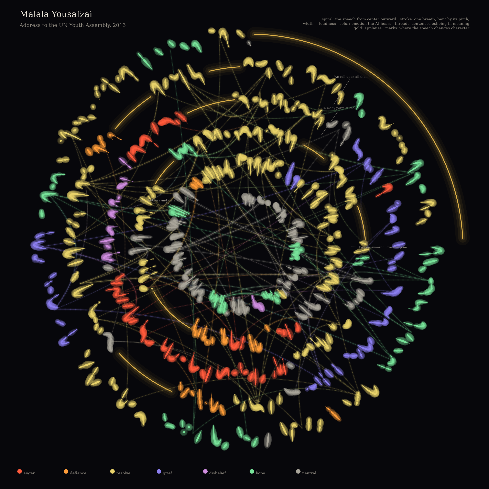

- **File:** `gallery/27_wiring_annotated_malala_2013_un.png` (from `output/malala_2013_un/art/wiring_annotated.png`)
- **Speech:** Malala Yousafzai, Address to the UN Youth Assembly, United Nations Headquarters, New York, 2013-07-12. 16.8 min of speech, 125 sentences, 91 words/min, 9 bursts of applause, most common emotion (AI): resolve.
- **What it shows:** The same portrait with the speech's sections marked and labeled by the words that open them, plus a legend. The sections were found by a novelty detector that only sees changes in meaning and delivery, yet they fall on the speech's real rhetorical turns.
- **Data:** as the portrait, plus output/<id>/structure/sections.csv
- **How it's made:** src/speechart/art/wiring.py with annotated=True.
- **AI and methods:** Whisper large-v3-turbo (speech recognition) with wav2vec2 forced alignment, via WhisperX; pYIN pitch tracking and RMS loudness (signal processing, not AI); PANNs Cnn14 (sound-event recognition trained on AudioSet) for applause, laughter and cheering; Gemini 2.5 Flash (LLM), 5 independent blind runs per speech combined by vote, for rhetorical devices, emotion, intensity and applause prediction; all-MiniLM-L6-v2 (sentence-embedding model) to measure similarity of meaning between sentences; Foote novelty on a self-similarity matrix (from music analysis) to find sections.

### Image 28: The Hidden Wiring of Speech, annotated: Martin Luther King Jr., I Have a Dream (1963)

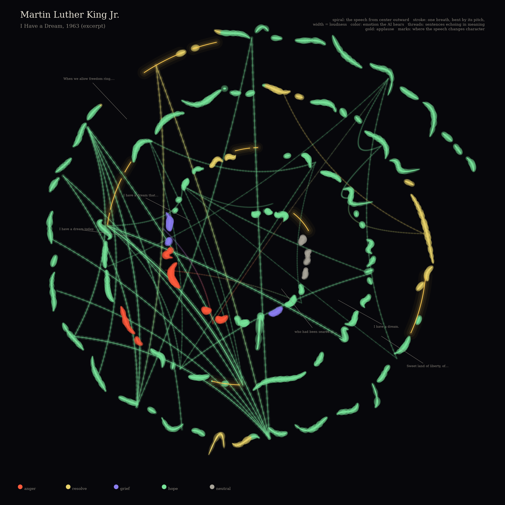

- **File:** `gallery/28_wiring_annotated_mlk_1963_dream.png` (from `output/mlk_1963_dream/art/wiring_annotated.png`)
- **Speech:** Martin Luther King Jr., I Have a Dream, Lincoln Memorial, Washington, D.C. (March on Washington), 1963-08-28 (edited excerpt). 6.5 min of speech, 45 sentences, 108 words/min, 10 bursts of applause, most common emotion (AI): hope.
- **What it shows:** The same portrait with the speech's sections marked and labeled by the words that open them, plus a legend. The sections were found by a novelty detector that only sees changes in meaning and delivery, yet they fall on the speech's real rhetorical turns.
- **Data:** as the portrait, plus output/<id>/structure/sections.csv
- **How it's made:** src/speechart/art/wiring.py with annotated=True.
- **AI and methods:** Whisper large-v3-turbo (speech recognition) with wav2vec2 forced alignment, via WhisperX; pYIN pitch tracking and RMS loudness (signal processing, not AI); PANNs Cnn14 (sound-event recognition trained on AudioSet) for applause, laughter and cheering; Gemini 2.5 Flash (LLM), 5 independent blind runs per speech combined by vote, for rhetorical devices, emotion, intensity and applause prediction; all-MiniLM-L6-v2 (sentence-embedding model) to measure similarity of meaning between sentences; Foote novelty on a self-similarity matrix (from music analysis) to find sections.

### Image 29: Phrase repetitions: Greta Thunberg, Address to the UN Climate Action Summit (2019)

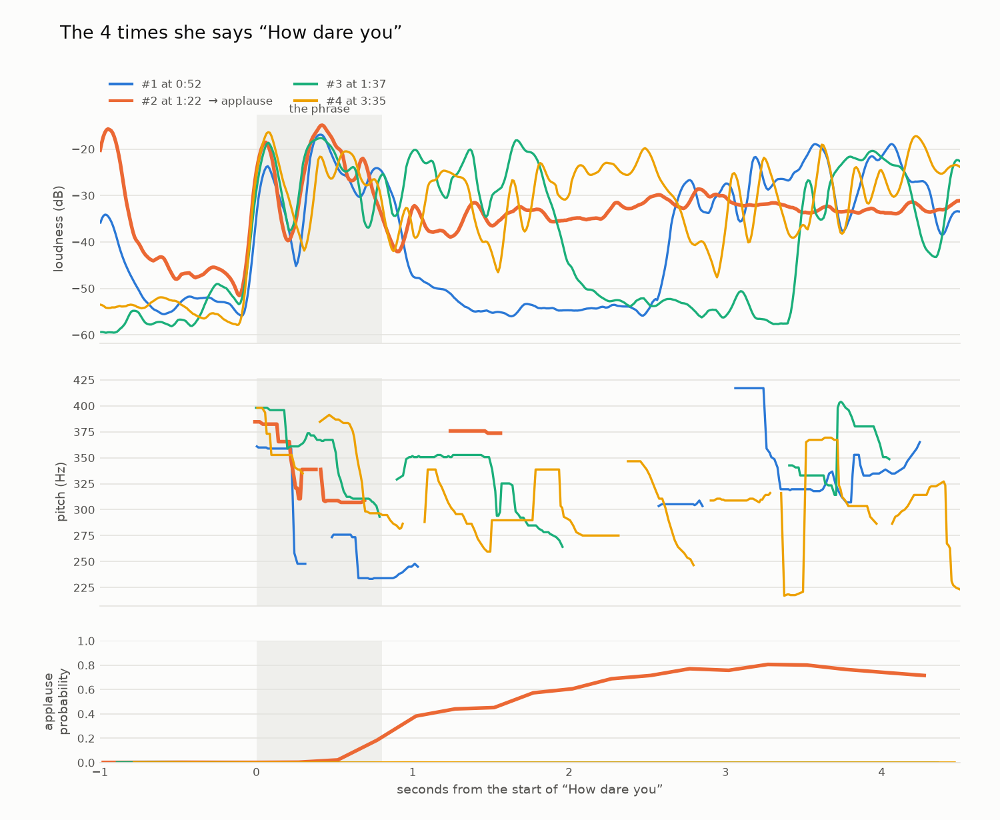

- **File:** `gallery/29_phrase_repetitions_thunberg_2019_un.png` (from `output/thunberg_2019_un/art/phrase_repetitions.png`)
- **Speech:** Greta Thunberg, Address to the UN Climate Action Summit, United Nations Headquarters, New York, 2019-09-23. 4.4 min of speech, 39 sentences, 111 words/min, 5 bursts of applause, most common emotion (AI): anger.
- **What it shows:** Every repetition of the speech's tracked phrase, overlaid and aligned on its first word: loudness, pitch and applause probability, so the deliveries can be compared like for like.
- **Data:** frames.csv, words_timeline.csv, reaction_scores.csv, reaction_events.csv
- **How it's made:** src/speechart/art/charts.py (analysis chart).
- **AI and methods:** Whisper large-v3-turbo (speech recognition) with wav2vec2 forced alignment, via WhisperX; pYIN pitch tracking and RMS loudness (signal processing, not AI); PANNs Cnn14 (sound-event recognition trained on AudioSet) for applause, laughter and cheering.

### Image 30: Phrase repetitions: Greta Thunberg, Address to the COP24 plenary (2018)

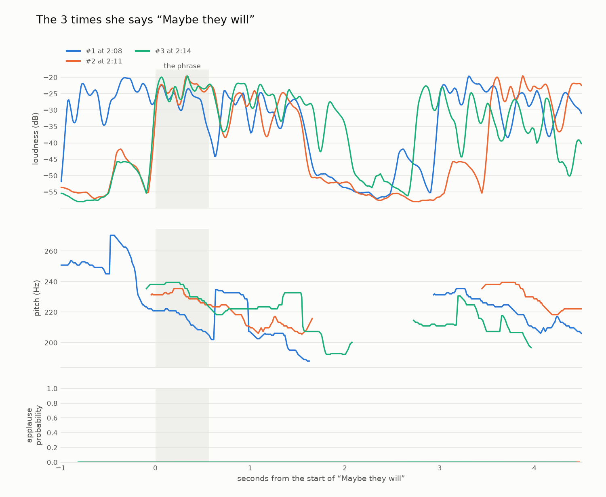

- **File:** `gallery/30_phrase_repetitions_thunberg_2018_cop24.png` (from `output/thunberg_2018_cop24/art/phrase_repetitions.png`)
- **Speech:** Greta Thunberg, Address to the COP24 plenary, COP24, Katowice, Poland, 2018-12-12. 3.4 min of speech, 34 sentences, 126 words/min, 1 bursts of applause, most common emotion (AI): anger.
- **What it shows:** Every repetition of the speech's tracked phrase, overlaid and aligned on its first word: loudness, pitch and applause probability, so the deliveries can be compared like for like.
- **Data:** frames.csv, words_timeline.csv, reaction_scores.csv, reaction_events.csv
- **How it's made:** src/speechart/art/charts.py (analysis chart).
- **AI and methods:** Whisper large-v3-turbo (speech recognition) with wav2vec2 forced alignment, via WhisperX; pYIN pitch tracking and RMS loudness (signal processing, not AI); PANNs Cnn14 (sound-event recognition trained on AudioSet) for applause, laughter and cheering.

### Image 31: Phrase repetitions: Malala Yousafzai, Address to the UN Youth Assembly (2013)

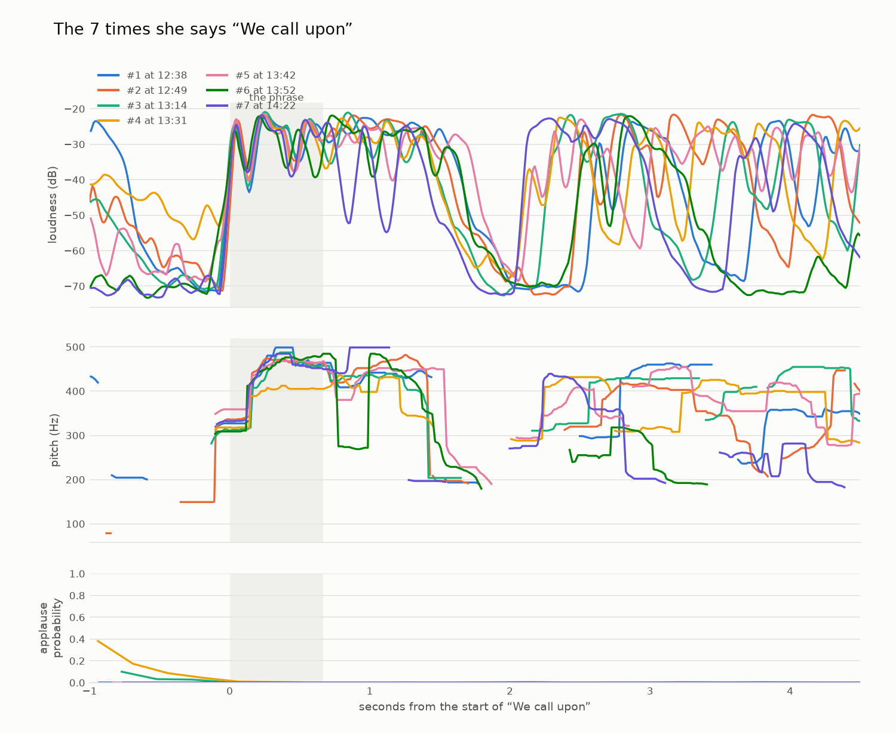

- **File:** `gallery/31_phrase_repetitions_malala_2013_un.png` (from `output/malala_2013_un/art/phrase_repetitions.png`)
- **Speech:** Malala Yousafzai, Address to the UN Youth Assembly, United Nations Headquarters, New York, 2013-07-12. 16.8 min of speech, 125 sentences, 91 words/min, 9 bursts of applause, most common emotion (AI): resolve.
- **What it shows:** Every repetition of the speech's tracked phrase, overlaid and aligned on its first word: loudness, pitch and applause probability, so the deliveries can be compared like for like.
- **Data:** frames.csv, words_timeline.csv, reaction_scores.csv, reaction_events.csv
- **How it's made:** src/speechart/art/charts.py (analysis chart).
- **AI and methods:** Whisper large-v3-turbo (speech recognition) with wav2vec2 forced alignment, via WhisperX; pYIN pitch tracking and RMS loudness (signal processing, not AI); PANNs Cnn14 (sound-event recognition trained on AudioSet) for applause, laughter and cheering.

### Image 32: Phrase repetitions: Martin Luther King Jr., I Have a Dream (1963)

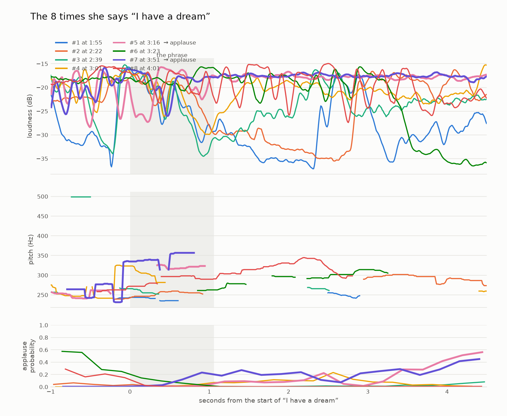

- **File:** `gallery/32_phrase_repetitions_mlk_1963_dream.png` (from `output/mlk_1963_dream/art/phrase_repetitions.png`)
- **Speech:** Martin Luther King Jr., I Have a Dream, Lincoln Memorial, Washington, D.C. (March on Washington), 1963-08-28 (edited excerpt). 6.5 min of speech, 45 sentences, 108 words/min, 10 bursts of applause, most common emotion (AI): hope.
- **What it shows:** Every repetition of the speech's tracked phrase, overlaid and aligned on its first word: loudness, pitch and applause probability, so the deliveries can be compared like for like.
- **Data:** frames.csv, words_timeline.csv, reaction_scores.csv, reaction_events.csv
- **How it's made:** src/speechart/art/charts.py (analysis chart).
- **AI and methods:** Whisper large-v3-turbo (speech recognition) with wav2vec2 forced alignment, via WhisperX; pYIN pitch tracking and RMS loudness (signal processing, not AI); PANNs Cnn14 (sound-event recognition trained on AudioSet) for applause, laughter and cheering.

### Image 33: Anatomy of applause: Greta Thunberg, Address to the UN Climate Action Summit (2019)

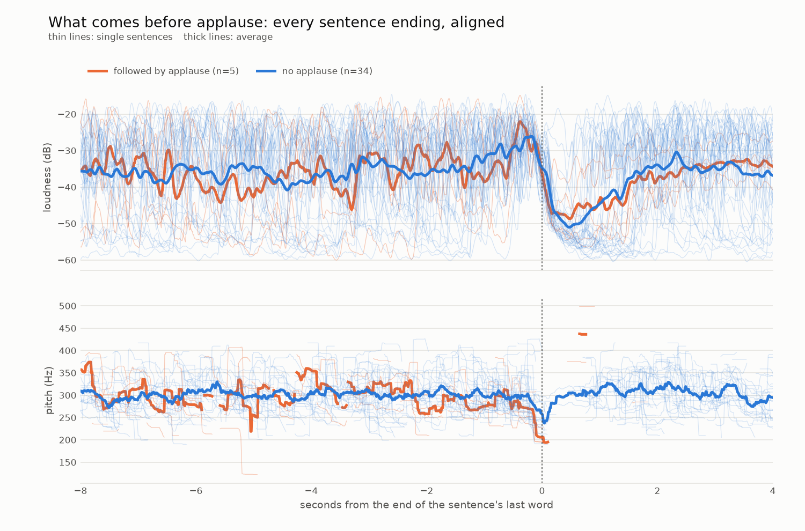

- **File:** `gallery/33_anatomy_of_applause_thunberg_2019_un.png` (from `output/thunberg_2019_un/art/anatomy_of_applause.png`)
- **Speech:** Greta Thunberg, Address to the UN Climate Action Summit, United Nations Headquarters, New York, 2019-09-23. 4.4 min of speech, 39 sentences, 111 words/min, 5 bursts of applause, most common emotion (AI): anger.
- **What it shows:** Every sentence ending aligned on its last word, split by whether applause followed: loudness and pitch in the seconds before and after, single sentences thin, averages thick.
- **Data:** frames.csv, words_timeline.csv (output/<id>/runup_curves.csv holds the same curves)
- **How it's made:** src/speechart/art/charts.py (analysis chart).
- **AI and methods:** Whisper large-v3-turbo (speech recognition) with wav2vec2 forced alignment, via WhisperX; pYIN pitch tracking and RMS loudness (signal processing, not AI); PANNs Cnn14 (sound-event recognition trained on AudioSet) for applause, laughter and cheering.

### Image 34: Anatomy of applause: Greta Thunberg, Address to the COP24 plenary (2018)

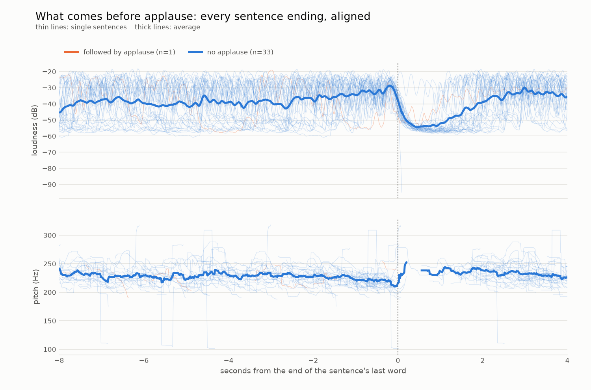

- **File:** `gallery/34_anatomy_of_applause_thunberg_2018_cop24.png` (from `output/thunberg_2018_cop24/art/anatomy_of_applause.png`)
- **Speech:** Greta Thunberg, Address to the COP24 plenary, COP24, Katowice, Poland, 2018-12-12. 3.4 min of speech, 34 sentences, 126 words/min, 1 bursts of applause, most common emotion (AI): anger.
- **What it shows:** Every sentence ending aligned on its last word, split by whether applause followed: loudness and pitch in the seconds before and after, single sentences thin, averages thick.
- **Data:** frames.csv, words_timeline.csv (output/<id>/runup_curves.csv holds the same curves)
- **How it's made:** src/speechart/art/charts.py (analysis chart).
- **AI and methods:** Whisper large-v3-turbo (speech recognition) with wav2vec2 forced alignment, via WhisperX; pYIN pitch tracking and RMS loudness (signal processing, not AI); PANNs Cnn14 (sound-event recognition trained on AudioSet) for applause, laughter and cheering.

### Image 35: Anatomy of applause: Malala Yousafzai, Address to the UN Youth Assembly (2013)

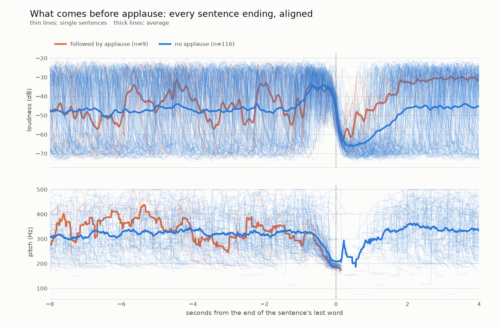

- **File:** `gallery/35_anatomy_of_applause_malala_2013_un.png` (from `output/malala_2013_un/art/anatomy_of_applause.png`)
- **Speech:** Malala Yousafzai, Address to the UN Youth Assembly, United Nations Headquarters, New York, 2013-07-12. 16.8 min of speech, 125 sentences, 91 words/min, 9 bursts of applause, most common emotion (AI): resolve.
- **What it shows:** Every sentence ending aligned on its last word, split by whether applause followed: loudness and pitch in the seconds before and after, single sentences thin, averages thick.
- **Data:** frames.csv, words_timeline.csv (output/<id>/runup_curves.csv holds the same curves)
- **How it's made:** src/speechart/art/charts.py (analysis chart).
- **AI and methods:** Whisper large-v3-turbo (speech recognition) with wav2vec2 forced alignment, via WhisperX; pYIN pitch tracking and RMS loudness (signal processing, not AI); PANNs Cnn14 (sound-event recognition trained on AudioSet) for applause, laughter and cheering.

### Image 36: Anatomy of applause: Martin Luther King Jr., I Have a Dream (1963)

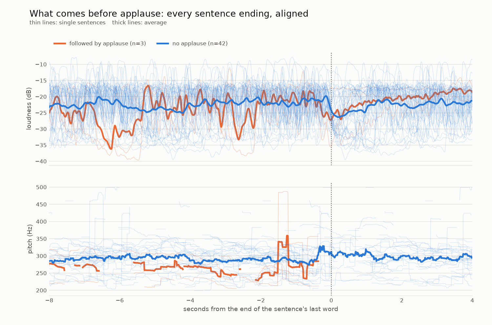

- **File:** `gallery/36_anatomy_of_applause_mlk_1963_dream.png` (from `output/mlk_1963_dream/art/anatomy_of_applause.png`)
- **Speech:** Martin Luther King Jr., I Have a Dream, Lincoln Memorial, Washington, D.C. (March on Washington), 1963-08-28 (edited excerpt). 6.5 min of speech, 45 sentences, 108 words/min, 10 bursts of applause, most common emotion (AI): hope.
- **What it shows:** Every sentence ending aligned on its last word, split by whether applause followed: loudness and pitch in the seconds before and after, single sentences thin, averages thick.
- **Data:** frames.csv, words_timeline.csv (output/<id>/runup_curves.csv holds the same curves)
- **How it's made:** src/speechart/art/charts.py (analysis chart).
- **AI and methods:** Whisper large-v3-turbo (speech recognition) with wav2vec2 forced alignment, via WhisperX; pYIN pitch tracking and RMS loudness (signal processing, not AI); PANNs Cnn14 (sound-event recognition trained on AudioSet) for applause, laughter and cheering.

### Image 37: Speech profiles

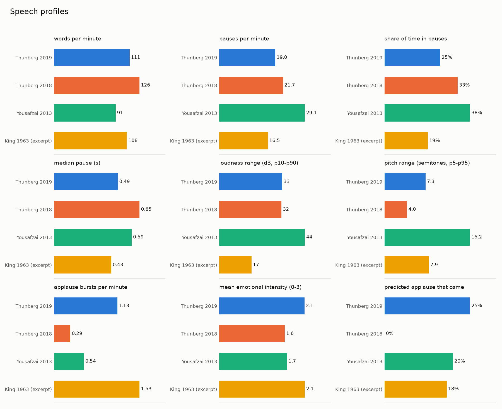

- **File:** `gallery/37_speech_profiles.png` (from `output/compare/speech_profiles.png`)
- **What it shows:** Small multiples comparing pace, pauses, loudness and pitch range, applause rate, AI-rated intensity and how often predicted applause came.
- **Data:** output/compare/metrics.csv
- **How it's made:** src/speechart/compare.py (analysis chart).
- **AI and methods:** Whisper large-v3-turbo (speech recognition) with wav2vec2 forced alignment, via WhisperX; pYIN pitch tracking and RMS loudness (signal processing, not AI); PANNs Cnn14 (sound-event recognition trained on AudioSet) for applause, laughter and cheering; Gemini 2.5 Flash (LLM), 5 independent blind runs per speech combined by vote, for rhetorical devices, emotion, intensity and applause prediction.

### Image 38: Rhetorical devices per speech

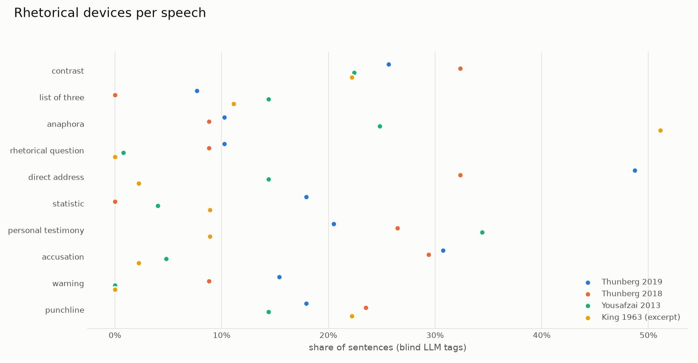

- **File:** `gallery/38_rhetorical_devices.png` (from `output/compare/rhetorical_devices.png`)
- **What it shows:** Share of sentences using each rhetorical device, per speech.
- **Data:** output/compare/metrics.csv (dev_* columns)
- **How it's made:** src/speechart/compare.py (analysis chart).
- **AI and methods:** Gemini 2.5 Flash (LLM), 5 independent blind runs per speech combined by vote, for rhetorical devices, emotion, intensity and applause prediction.

### Image 39: The run-up to applause, compared

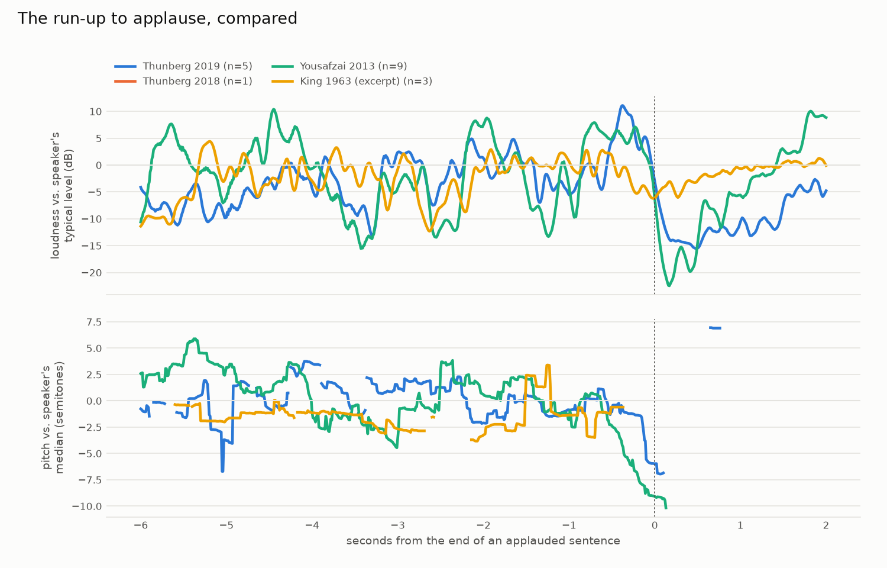

- **File:** `gallery/39_applause_runup.png` (from `output/compare/applause_runup.png`)
- **What it shows:** Loudness and pitch before applauded sentence endings, relative to each speaker's own typical level, one line per speech.
- **Data:** output/compare/runup_curves_all.csv
- **How it's made:** src/speechart/compare.py (analysis chart).
- **AI and methods:** Whisper large-v3-turbo (speech recognition) with wav2vec2 forced alignment, via WhisperX; pYIN pitch tracking and RMS loudness (signal processing, not AI); PANNs Cnn14 (sound-event recognition trained on AudioSet) for applause, laughter and cheering.

### Image 40: The echo of each speech on Wikipedia

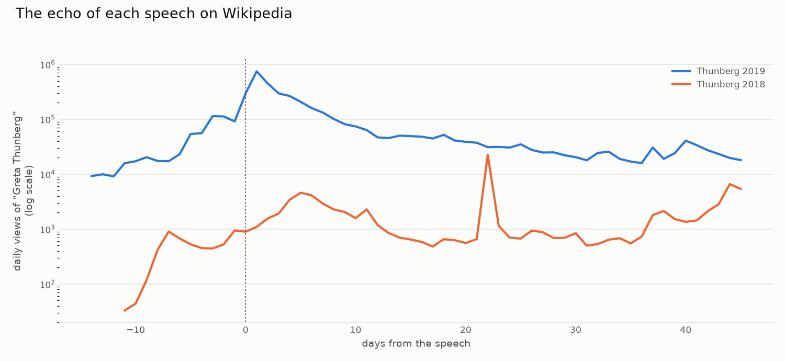

- **File:** `gallery/40_echo_wikipedia.png` (from `output/compare/echo_wikipedia.png`)
- **What it shows:** Daily Wikipedia views of the speaker's article around each speech, aligned on the speech day (log scale).
- **Data:** aftermath_wikipedia.csv (Wikimedia pageviews)
- **How it's made:** src/speechart/compare.py (analysis chart).

### Image 41: Speech Fingerprints side by side

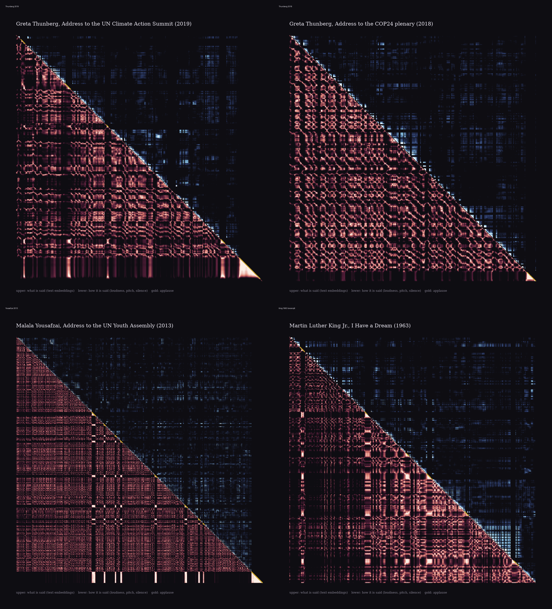

- **File:** `gallery/41_fingerprints_sheet.png` (from `output/compare/fingerprints.png`)
- **What it shows:** The four fingerprints on one sheet.
- **Data:** see Speech Fingerprint
- **How it's made:** src/speechart/compare.py (contact sheet).
- **AI and methods:** all-MiniLM-L6-v2 (sentence-embedding model) to measure similarity of meaning between sentences; Whisper large-v3-turbo (speech recognition) with wav2vec2 forced alignment, via WhisperX; pYIN pitch tracking and RMS loudness (signal processing, not AI); PANNs Cnn14 (sound-event recognition trained on AudioSet) for applause, laughter and cheering.

### Image 42: Applause Landscapes stacked

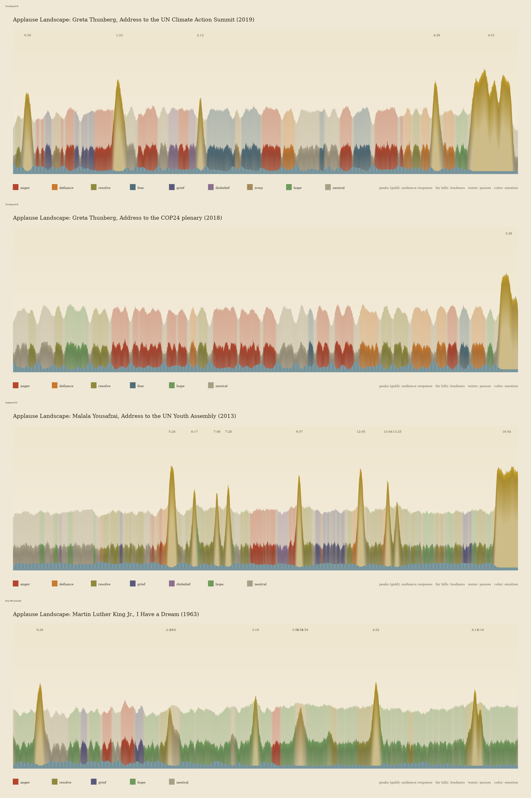

- **File:** `gallery/42_landscapes_sheet.png` (from `output/compare/landscapes.png`)
- **What it shows:** The four landscapes on one sheet.
- **Data:** see Applause Landscape
- **How it's made:** src/speechart/compare.py (contact sheet).
- **AI and methods:** pYIN pitch tracking and RMS loudness (signal processing, not AI); PANNs Cnn14 (sound-event recognition trained on AudioSet) for applause, laughter and cheering; Gemini 2.5 Flash (LLM), 5 independent blind runs per speech combined by vote, for rhetorical devices, emotion, intensity and applause prediction; Whisper large-v3-turbo (speech recognition) with wav2vec2 forced alignment, via WhisperX.

